# Flujo del workflow "SISTEMA AUTOMATIZADO PEGASO"

Recorrido completo del workflow de producción: qué hace cada nodo, de quién recibe datos y a quién los envía.

> **Fuente:** versión de producción con `updatedAt 2026-10-13T16:28:08.664Z` (`versionId 3e62b91c…`), descargada vía Node (sin mojibake).
> **Contenido:** 186 nodos, 223 conexiones (211 de flujo `main`, 9 de modelo de lenguaje `ai_languageModel`, 3 de parser `ai_outputParser`).
> Si el workflow cambia, este documento debe actualizarse a mano (ver §17).

Documentos relacionados: [ARQUITECTURA-PEGASO-N8N.md](ARQUITECTURA-PEGASO-N8N.md) (repo y scripts) · [GUIA-USO-PEGASO-N8N.md](GUIA-USO-PEGASO-N8N.md) (runbook).

---

## Índice

1. [Convenciones de lectura](#1-convenciones-de-lectura)
2. [Vista general](#2-vista-general)
3. [Disparadores y verificación Meta](#3-disparadores-y-verificación-meta)
4. [Entrada WhatsApp y enrutamiento inicial](#4-entrada-whatsapp-y-enrutamiento-inicial)
5. [Comandos de administrador (MODO_PRUEBA y ACTIVEBOT)](#5-comandos-de-administrador-modo_prueba-y-activebot)
6. [Intervención humana desde WhatsApp de Pegaso](#6-intervención-humana-desde-whatsapp-de-pegaso)
7. [Contacto, prospecto y conversación](#7-contacto-prospecto-y-conversación)
8. [Guardado, permiso del bot y ventana de turno](#8-guardado-permiso-del-bot-y-ventana-de-turno)
9. [Turno conversacional e imágenes](#9-turno-conversacional-e-imágenes)
10. [Audio](#10-audio)
11. [Cerebro comercial](#11-cerebro-comercial)
12. [Respuesta comercial (acciones sin cotización)](#12-respuesta-comercial-acciones-sin-cotización)
13. [Cotización](#13-cotización)
14. [Post-cotización](#14-post-cotización)
15. [Derivación humana (handoff) y notificación](#15-derivación-humana-handoff-y-notificación)
16. [Salida WhatsApp](#16-salida-whatsapp)
17. [Sub-nodos de IA, nodos aislados y puntos finales](#17-sub-nodos-de-ia-nodos-aislados-y-puntos-finales)
18. [Observaciones y posibles problemas](#18-observaciones-y-posibles-problemas)

---

## 1. Convenciones de lectura

- **[T] / [F]**: salida *true* (`main[0]`) / *false* (`main[1]`) de un nodo IF.
- **[err]**: salida de error (`main[1]`) de un nodo con `onError: continueErrorOutput`.
- **"Lee además"**: nodos que un Code Node consulta con `$('Nombre')` además de su entrada directa. Si se renombra uno de esos nodos, el Code Node se rompe.
- **Postgres**: todas las tablas están en el esquema `pegaso`. Los nodos sin operación explícita usan la operación por defecto del nodo Postgres v2.7 (**insert**).
- **Merge** (`Unificar …`): sin parámetros, modo por defecto (**append**): deja pasar lo que llega por cualquiera de sus dos entradas. Se usan para reunir la rama "existe" y la rama "creado".
- Cuando una salida no está conectada, el flujo **termina** en ese punto para ese item.
- Los Code Nodes están en `code/_extraidos/<nombre-normalizado>.js` (ver `manifest.json`).

---

## 2. Vista general

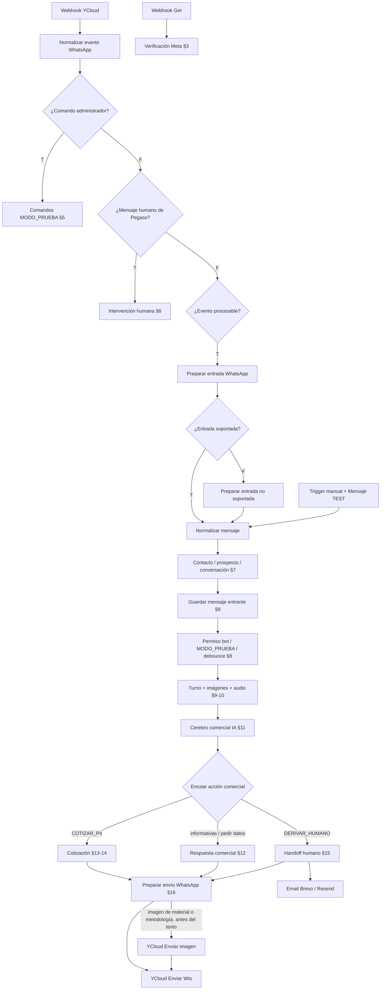

Principios que se repiten en todo el flujo:

- **Proveedores de IA en cascada**: Groq → DeepSeek → OpenAI. Cada intento pasa por un validador; si no es válido, se prueba el siguiente proveedor.
- **Los nodos Postgres devuelven solo la fila de BD**, por eso muchos Code Nodes recuperan el contrato completo de nodos anteriores con `$('…')`.
- **El mensaje se guarda antes de responder**: entrante en §8, saliente en §12/§13/§15, y luego se envía (§16).

---

## 3. Disparadores y verificación Meta

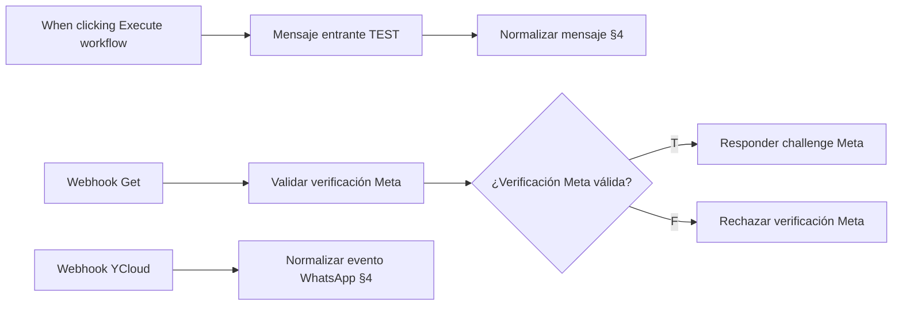

| Nodo | Tipo | Qué hace | Recibe de | Envía a |
|---|---|---|---|---|
| When clicking ‘Execute workflow’ | Manual Trigger | Disparo manual desde el editor para pruebas | — | Mensaje entrante TEST |
| Mensaje entrante TEST | Set (raw JSON) | Simula un mensaje entrante fijo (teléfono, nombre, texto, canal `WHATSAPP`, id externo de prueba) | When clicking ‘Execute workflow’ | Normalizar mensaje |
| Webhook Get | Webhook `GET /whatsapp-meta` (responde vía nodo) | Recibe la verificación de webhook de Meta | — | Validar verificación Meta |
| Validar verificación Meta | Code | Lee `hub.mode`, `hub.verify_token`, `hub.challenge` y compara el token con el esperado; emite `meta_verificacion.valido` y `challenge` | Webhook Get | If: ¿Verificación Meta válida? |
| If: ¿Verificación Meta válida? | IF `meta_verificacion.valido` | Decide respuesta a Meta | Validar verificación Meta | [T] Responder challenge Meta · [F] Rechazar verificación Meta |
| Responder challenge Meta | Respond to Webhook | Responde `200` con el `challenge` | If [T] | — (fin) |
| Rechazar verificación Meta | Respond to Webhook | Responde `403 Forbidden` | If [F] | — (fin) |
| Webhook YCloud | Webhook `POST /whatsapp-ycloud` (responde al recibir) | **Entrada principal en producción**: eventos de YCloud | — | Normalizar evento WhatsApp |

`Webhook Post` (`POST /whatsapp-meta`) y `Respond to Webhook Post` existen pero **no están conectados** (ver §17).

---

## 4. Entrada WhatsApp y enrutamiento inicial

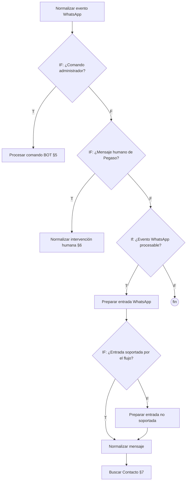

| Nodo | Tipo | Qué hace | Recibe de | Envía a |
|---|---|---|---|---|
| Normalizar evento WhatsApp | Code | Detecta el origen del webhook (YCloud inbound `whatsapp.inbound_message.received`, YCloud eco de WhatsApp Business `whatsapp.smb.message.echoes`, Meta Cloud API `body.entry`) y produce un `evento_whatsapp` uniforme: teléfono, nombre, id, tipo, texto, multimedia. Clasifica `clasificacion_mensaje`: `ENTRANTE_CLIENTE` (inbound), `SALIENTE_AUTOMATICO` (eco cuyo texto coincide con una automatización de WhatsApp Business de la lista `AUTOMATIZACIONES_WHATSAPP_BUSINESS`; expone `accion_equivalente`, por ejemplo `PEDIR_MEDIDAS`, `SALUDO` o `INFORMAR_MATERIAL`; incluye las respuestas de las preguntas rápidas de los anuncios de Facebook, como "Trabajamos con Plástico Polipropileno de alta adherencia…") o `SALIENTE_HUMANO` (cualquier otro eco). Todo eco tiene `direccion = SALIENTE`. Expone `es_lead_anuncio` y `anuncio` desde `referral` del inbound (anuncios click-to-WhatsApp). No guarda nada | Webhook YCloud | IF: ¿Comando administrador? |
| IF: ¿Comando administrador? | IF (expresión sobre teléfono y texto del evento) | Detecta comandos de administración desde teléfonos administradores: `STOP`, `START` o `ACTIVEBOT <teléfono>` (§5) | Normalizar evento WhatsApp | [T] Procesar comando BOT · [F] IF: ¿Mensaje humano de Pegaso? |
| IF: ¿Mensaje humano de Pegaso? | IF `evento_whatsapp.direccion === 'SALIENTE'` o `es_mensaje_humano_pegaso` | Separa **todo** eco saliente de WhatsApp Business (humano o automático): un eco nunca entra como mensaje del cliente ni llega al cerebro | IF: ¿Comando administrador? [F] | [T] Normalizar intervención humana · [F] If: ¿Evento WhatsApp procesable? |
| If: ¿Evento WhatsApp procesable? | IF `evento_whatsapp.procesable` | Descarta eventos que no son mensajes procesables (por ejemplo estados) | IF: ¿Mensaje humano de Pegaso? [F] | [T] Preparar entrada WhatsApp · [F] **fin** |
| Preparar entrada WhatsApp | Code | Valida teléfono e id; traduce el tipo a enum interno (`TEXTO`, `IMAGEN`, `AUDIO`, `VIDEO`, `DOCUMENTO`, `STICKER`, …). Para imagen/audio crea un descriptor `[IMAGEN]/[AUDIO]` + `[MEDIA_PENDIENTE] {json}` que se guarda en `mensajes.contenido`. Emite `apto_para_flujo_conversacional` | If: ¿Evento WhatsApp procesable? [T] | IF: ¿Entrada soportada por el flujo? |
| IF: ¿Entrada soportada por el flujo? | IF `apto_para_flujo_conversacional` | Separa entradas que el bot puede atender | Preparar entrada WhatsApp | [T] Normalizar mensaje · [F] Preparar entrada no soportada |
| Preparar entrada no soportada | Code | Convierte una entrada no soportada (video, documento, sticker…) en un mensaje válido marcado para humano (`requiere_humano_entrada`, `motivo_derivacion_entrada`). No deriva todavía | IF: ¿Entrada soportada…? [F] | Normalizar mensaje |
| Normalizar mensaje | Code | Unifica la entrada real y la de TEST: teléfono, nombre, mensaje, tipo, canal y metadatos multimedia. No llama IA ni BD | Mensaje entrante TEST · IF: ¿Entrada soportada…? [T] · Preparar entrada no soportada | Buscar Contacto |

---

## 5. Comandos de administrador (MODO_PRUEBA y ACTIVEBOT)

Se envían por WhatsApp al número del bot desde un teléfono administrador (`IF: ¿Comando administrador?` y `Procesar comando BOT` tienen la misma lista). Mayúsculas o minúsculas da igual.

| Comando | Efecto |
|---|---|
| `STOP` | Activa MODO_PRUEBA (el bot solo responde a teléfonos autorizados) |
| `START` | Desactiva MODO_PRUEBA |
| `ACTIVEBOT 0999999999` | El bot vuelve a atender a ese prospecto: `requiere_humano = FALSE` y deja de contar la guardia humana de 10 minutos. Acepta `0999999999`, `999999999`, `593999999999` o `+593 99 999 9999` |

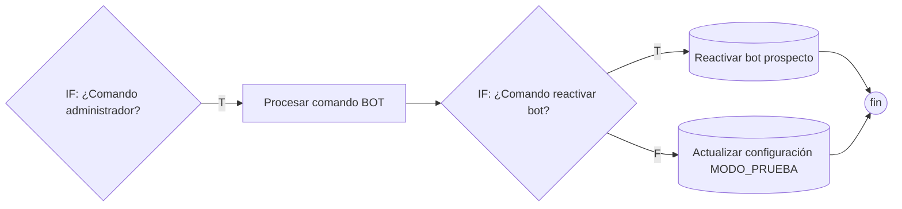

| Nodo | Tipo | Qué hace | Recibe de | Envía a |
|---|---|---|---|---|
| Procesar comando BOT | Code | Interpreta comandos de teléfonos administradores autorizados: `STOP` activa MODO_PRUEBA, `START` lo desactiva, `ACTIVEBOT <teléfono>` reactiva el bot para un prospecto. Emite `comando_bot`, `modo_prueba_nuevo` y `telefono_objetivo` (solo dígitos con prefijo 593; con un teléfono inválido lanza error) | IF: ¿Comando administrador? [T] | IF: ¿Comando reactivar bot? |
| IF: ¿Comando reactivar bot? | IF `comando_bot === 'ACTIVEBOT'` | Separa ACTIVEBOT de STOP/START | Procesar comando BOT | [T] Reactivar bot prospecto · [F] Actualizar configuración MODO_PRUEBA |
| Reactivar bot prospecto | Postgres (SQL) | En una sola sentencia: `requiere_humano = FALSE` en el o los prospectos WHATSAPP con ese teléfono e inserta en su conversación (la ACTIVA, si no la más reciente) el SALIENTE interno `[BOT REACTIVADO POR ADMINISTRADOR]` sin `mensaje_externo_id`. El teléfono guardado se compara normalizado igual que `telefono_objetivo` (solo dígitos; `09…` y 9 dígitos pasan a `593…`), sin exigir `activo`. No toca `ultima_accion`. Devuelve `prospectos_reactivados` (0 si el teléfono no existe), `prospecto_id`, `telefono_guardado`, `prospecto_activo`, `conversacion_id`, `marcador_id` | IF: ¿Comando reactivar bot? [T] | — (**fin**, no responde al administrador) |
| Actualizar configuración MODO_PRUEBA | Postgres (SQL) | `UPDATE pegaso.configuracion_bot` → `valor_json.activo` de la clave `MODO_PRUEBA` | IF: ¿Comando reactivar bot? [F] | — (**fin**, no responde al administrador) |

El marcador `[BOT REACTIVADO POR ADMINISTRADOR]` es lo que permite al bot responder de inmediato: `Resolver turno conversacional` ignora los SALIENTE humanos anteriores a él, y `Preparar contexto IA` lo excluye del historial y de `ultimo_saliente`. Si un humano de Pegaso vuelve a escribir después del comando, la bandera y la guardia se activan otra vez como siempre.

---

## 6. Intervención humana desde WhatsApp de Pegaso

Cuando alguien de Pegaso escribe al cliente desde WhatsApp Business, el bot registra ese mensaje y marca al prospecto como atendido por humano. Las respuestas automáticas de WhatsApp Business (saludo, respuesta de anuncio) siguen la misma ruta: se registran como SALIENTE con el prefijo `[AUTOMATICO WHATSAPP BUSINESS · accion=...]`, pero **no** marcan `requiere_humano`.

Origen de cada SALIENTE en `mensajes` (sin columnas nuevas): sin `mensaje_externo_id` → lo envió el bot; con `mensaje_externo_id` y el prefijo anterior → automatización de WhatsApp Business; con `mensaje_externo_id` sin prefijo → humano.

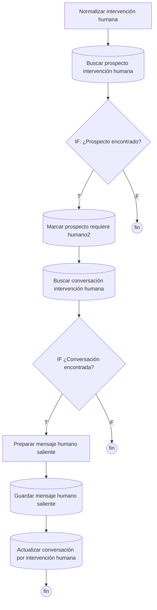

| Nodo | Tipo | Qué hace | Recibe de | Envía a |
|---|---|---|---|---|
| Normalizar intervención humana | Code | Para mensajes de Pegaso: cliente = destinatario (`TO`), Pegaso = emisor. Extrae teléfono del cliente, tipo y contenido. Emite `intervencion_humana` (`false` para automatizaciones) y `origen_mensaje` (`HUMANO` / `AUTOMATICO_WHATSAPP_BUSINESS`); al contenido automático le antepone `[AUTOMATICO WHATSAPP BUSINESS · accion=...]` | IF: ¿Mensaje humano de Pegaso? [T] | Buscar prospecto intervención humana |
| Buscar prospecto intervención humana | Postgres (SQL) | `SELECT` en `prospectos` por teléfono (solo dígitos), canal `WHATSAPP`, activo. Calcula además `respuesta_rapida_apertura`: el eco es texto de 80 caracteres o más, llega a 15 s o menos del último ENTRANTE del prospecto y ese ENTRANTE abre la conversación (sin otros mensajes del prospecto entre 24 h y 30 s antes). Es la red de seguridad para respuestas automáticas de anuncios sin huella. Devuelve también `segundos_desde_entrante` | Normalizar intervención humana | IF: ¿Prospecto encontrado? |
| IF: ¿Prospecto encontrado? | IF `prospecto_id > 0` | | Buscar prospecto… | [T] Marcar prospecto requiere humano2 · [F] **fin** |
| Marcar prospecto requiere humano2 | Postgres (SQL) | `UPDATE prospectos`: si `intervencion_humana` es verdadera y el eco no es `respuesta_rapida_apertura`, `requiere_humano = TRUE` y `ultima_accion = 'DERIVAR_HUMANO'`; un eco automático solo toca `actualizado_at` (nunca apaga una bandera ya levantada) | IF [T] | Buscar conversación intervención humana |
| Buscar conversación intervención humana | Postgres (SQL) | `SELECT` la conversación WhatsApp más reciente del prospecto | Marcar prospecto requiere humano2 | IF ¿Conversación encontrada? |
| IF ¿Conversación encontrada? | IF `conversacion_id > 0` | | Buscar conversación… | [T] Preparar mensaje humano saliente · [F] **fin** |
| Preparar mensaje humano saliente | Code | Arma la fila SALIENTE del eco (humano o automático) conservando `mensaje_externo_id`, `origen_mensaje` e `intervencion_humana`. Si `Buscar prospecto intervención humana` marcó `respuesta_rapida_apertura`, lo guarda como automático: `[AUTOMATICO WHATSAPP BUSINESS · accion=NINGUNA · motivo=RESPUESTA_RAPIDA_APERTURA]`, `intervencion_humana = false`. Lee además: Normalizar intervención humana, Buscar prospecto intervención humana | IF [T] | Guardar mensaje humano saliente |
| Guardar mensaje humano saliente | Postgres (SQL) | `INSERT INTO mensajes` (`SALIENTE`, procesado) con `ON CONFLICT (mensaje_externo_id) DO NOTHING` | Preparar mensaje humano saliente | Actualizar conversación por intervención humana |
| Actualizar conversación por intervención humana | Postgres (SQL) | `UPDATE conversaciones SET ultimo_mensaje_at` | Guardar mensaje humano saliente | — (**fin**) |

---

## 7. Contacto, prospecto y conversación

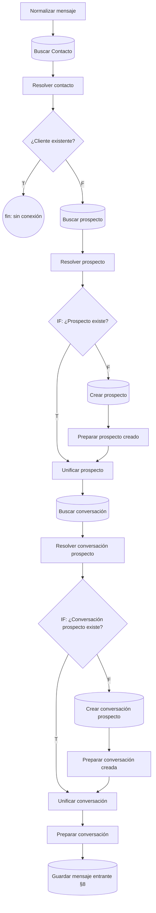

| Nodo | Tipo | Qué hace | Recibe de | Envía a |
|---|---|---|---|---|
| Buscar Contacto | Postgres select `contactos` | Busca un contacto por `whatsapp = telefono` (siempre devuelve salida) | Normalizar mensaje | Resolver contacto |
| Resolver contacto | Code | Combina el mensaje con el resultado de la búsqueda; emite `es_cliente_registrado`. Lee además: Normalizar mensaje | Buscar Contacto | ¿Cliente existente? |
| ¿Cliente existente? | IF `es_cliente_registrado` | Separa clientes registrados de prospectos | Resolver contacto | [T] **sin conexión (fin)** · [F] Buscar prospecto |
| Buscar prospecto | Postgres select `prospectos` | Por `telefono`, `canal`, `activo = true` (siempre devuelve salida) | ¿Cliente existente? [F] | Resolver prospecto |
| Resolver prospecto | Code | Determina `prospecto_existe` conservando el mensaje original. Lee además: Resolver contacto | Buscar prospecto | IF: ¿Prospecto existe? |
| IF: ¿Prospecto existe? | IF `prospecto_existe` | | Resolver prospecto | [T] Unificar prospecto · [F] Crear prospecto |
| Crear prospecto | Postgres insert `prospectos` | Inserta teléfono, nombre, canal, origen, estado, activo, `requiere_humano` | IF [F] | Preparar prospecto creado |
| Preparar prospecto creado | Code | Convierte la fila insertada al mismo formato que "Resolver prospecto". Lee además: Resolver prospecto | Crear prospecto | Unificar prospecto (entrada 2) |
| Unificar prospecto | Merge (append) | Reúne prospecto existente y prospecto creado | IF [T] · Preparar prospecto creado | Buscar conversación |
| Buscar conversación | Postgres select `conversaciones` | Por `prospecto_id`, `canal`, `estado = 'ACTIVA'` (siempre devuelve salida) | Unificar prospecto | Resolver conversación prospecto |
| Resolver conversación prospecto | Code | Interpreta la búsqueda (`conversacion_existe`), expone ids y `conversacion_contexto_comercial` (memoria persistida). No crea. Lee además: Unificar prospecto | Buscar conversación | IF: ¿Conversación prospecto existe? |
| IF: ¿Conversación prospecto existe? | IF `conversacion_existe` | | Resolver conversación prospecto | [T] Unificar conversación · [F] Crear conversación prospecto |
| Crear conversación prospecto | Postgres insert `conversaciones` | Inserta `prospecto_id`, teléfono, canal, estado, `ultimo_mensaje_at` | IF [F] | Preparar conversación creada |
| Preparar conversación creada | Code | Valida el id creado y lo une al contrato original. Lee además: Resolver conversación prospecto | Crear conversación prospecto | Unificar conversación (entrada 2) |
| Unificar conversación | Merge (append) | Reúne conversación existente y creada | IF [T] · Preparar conversación creada | Preparar conversación |
| Preparar conversación | Code | Estructura uniforme para guardar el mensaje, recuperar historial y preparar la IA: ids, actor (cliente/contacto/prospecto), `contexto_comercial` parseado (tolera string/JSON inválido), flags | Unificar conversación | Guardar mensaje entrante |

---

## 8. Guardado, permiso del bot y ventana de turno

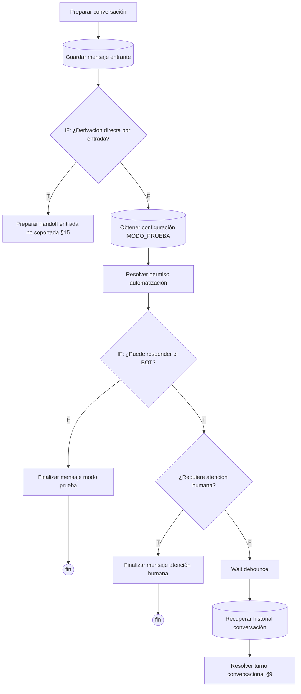

| Nodo | Tipo | Qué hace | Recibe de | Envía a |
|---|---|---|---|---|
| Guardar mensaje entrante | Postgres insert `mensajes` | Guarda el mensaje ENTRANTE (`procesado`, conversación, cliente, dirección, tipo, contenido, id externo, fecha) | Preparar conversación | IF: ¿Derivación directa por entrada? |
| IF: ¿Derivación directa por entrada? | IF `$json.puede_responder_bot` | Pretende enviar directo a humano las entradas no soportadas. **Ver §18: la condición parece incorrecta** | Guardar mensaje entrante | [T] Preparar handoff entrada no soportada · [F] Obtener configuración MODO_PRUEBA |
| Obtener configuración MODO_PRUEBA | Postgres (SQL) | `SELECT` en `configuracion_bot` de las claves `MODO_PRUEBA`, `DEBOUNCE_WHATSAPP`, `IMAGEN_MATERIAL` e `IMAGEN_METODOLOGIA` (las dos últimas las lee `Resolver contexto comercial`) | IF [F] | Resolver permiso automatización |
| Resolver permiso automatización | Code | Si MODO_PRUEBA está inactivo, el bot atiende a todos; si está activo, solo a teléfonos autorizados. Ante configuración ausente o inválida asume MODO_PRUEBA activo (seguro). Emite `puede_responder_bot`, `motivo_bloqueo_bot` y la configuración de debounce (`debounce_segundos`, `debounce_motivo`). En primer contacto (lead de anuncio, conversación nueva o sin turno del bot en 24 h) usa `debounce_primer_contacto_ms` de `DEBOUNCE_WHATSAPP` (10 s por defecto, máximo 15 s) para que el eco automático de WhatsApp Business llegue antes de resolver el turno. Lee además: Normalizar mensaje, Preparar conversación, Normalizar evento WhatsApp | Obtener configuración MODO_PRUEBA | IF: ¿Puede responder el BOT? |
| IF: ¿Puede responder el BOT? | IF `puede_responder_bot` | | Resolver permiso automatización | [T] ¿Requiere atención humana? · [F] Finalizar mensaje modo prueba |
| Finalizar mensaje modo prueba | Code | Cierre sin IA, sin cotizar y sin responder (el mensaje ya quedó guardado) | IF [F] | — (**fin**) |
| ¿Requiere atención humana? | IF `$('Unificar prospecto').first().json.prospecto_requiere_humano` | Si el prospecto ya está con un humano, el bot no responde | IF: ¿Puede responder el BOT? [T] | [T] Finalizar mensaje atención humana · [F] Wait |
| Finalizar mensaje atención humana | Code | Cierre `ATENCION_HUMANA` sin respuesta automática | ¿Requiere atención humana? [T] | — (**fin**) |
| Wait | Wait (`debounce_segundos` de Resolver permiso automatización) | Ventana de agrupación: espera por si el cliente envía más mensajes seguidos | ¿Requiere atención humana? [F] | Recuperar historial conversación |
| Recuperar historial conversación | Postgres select `mensajes` | Todos los mensajes de la conversación, ordenados por `enviado_at` | Wait | Resolver turno conversacional |

---

## 9. Turno conversacional e imágenes

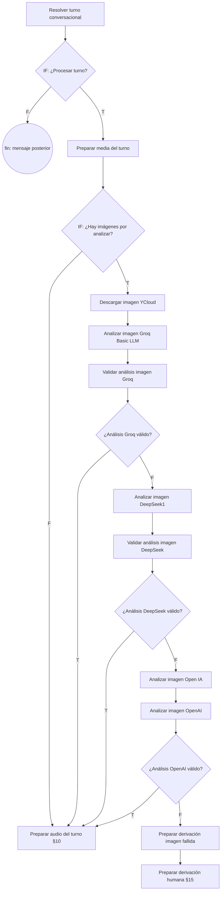

| Nodo | Tipo | Qué hace | Recibe de | Envía a |
|---|---|---|---|---|
| Resolver turno conversacional | Code | Decide si esta ejecución corresponde al **último** mensaje ENTRANTE (gana el último). Si llegó uno posterior, devuelve `continuar_procesamiento = false` (`DEBOUNCE_SUPERSEDED`). Guardia humana posterior a la espera: si hay un SALIENTE humano posterior a este mensaje o de hace menos de 10 minutos, no procesa (`ATENCION_HUMANA`); los humanos anteriores al último marcador `[BOT REACTIVADO POR ADMINISTRADOR]` (comando ACTIVEBOT, §5) no cuentan. Si es el último, arma el turno con los ENTRANTES no procesados posteriores al último SALIENTE (los ecos automáticos de WhatsApp Business no cortan el turno). Ignora reenvíos del mismo id externo. Lee además: Guardar mensaje entrante, Unificar conversación, Preparar conversación, Unificar prospecto, Resolver prospecto, Resolver permiso automatización | Recuperar historial conversación | IF: ¿Procesar turno? |
| IF: ¿Procesar turno? | IF `continuar_procesamiento` | | Resolver turno conversacional | [T] Preparar media del turno · [F] **fin** |
| Preparar media del turno | Code | Busca imágenes `[MEDIA_PENDIENTE]` del turno; revalida MIME (JPEG/PNG/WebP) y que el enlace sea de YCloud (anti-SSRF); límite por turno. Emite un item por imagen (`analizar_imagen = true`) o uno solo con `false`. Lee además: Resolver turno conversacional, Preparar conversación | IF: ¿Procesar turno? [T] | IF: ¿Hay imágenes por analizar? |
| IF: ¿Hay imágenes por analizar? | IF `analizar_imagen` | | Preparar media del turno | [T] Descargar imagen YCloud · [F] Preparar audio del turno |
| Descargar imagen YCloud | HTTP GET `media_link` (credencial Header Auth) | Descarga el binario de la imagen | IF [T] | [ok] Analizar imagen Groq Basic LLM · [err] sin conexión |
| Analizar imagen Groq Basic LLM | Basic LLM Chain (modelo: Groq Chat Model2; parser: Schema análisis imagen) | Analista visual: extrae la evidencia relevante (envase, etiqueta, logo, comprobante, medidas escritas…) en JSON | Descargar imagen YCloud | [ok] y [err] Validar análisis imagen Groq |
| Validar análisis imagen Groq | Code | Valida el contrato del análisis; normaliza medidas escritas; `analisis_valido = false` si Groq falló. Lee además: Preparar media del turno | Analizar imagen Groq… (ok y err) | IF: ¿Análisis Groq válido? |
| IF: ¿Análisis Groq válido? | IF `analisis_valido` | | Validar análisis imagen Groq | [T] Preparar audio del turno · [F] Analizar imagen DeepSeek1 |
| Analizar imagen DeepSeek1 | Basic LLM Chain (modelo: Analizar imagen DeepSeek; parser: Schema análisis imagen1) | Mismo análisis con DeepSeek | IF Groq [F] | [ok] y [err] Validar análisis imagen DeepSeek |
| Validar análisis imagen DeepSeek | Code | Misma validación (lógica duplicada del validador Groq). Lee además: Preparar media del turno | Analizar imagen DeepSeek1 | IF: ¿Análisis DeepSeek válido? |
| IF: ¿Análisis DeepSeek válido? | IF `analisis_valido` | | Validar análisis imagen DeepSeek | [T] Preparar audio del turno · [F] Analizar imagen Open IA |
| Analizar imagen Open IA | Basic LLM Chain (modelo: OpenAI Chat; parser: Schema análisis imagen2) | Mismo análisis con OpenAI | IF DeepSeek [F] | [ok] y [err] Analizar imagen OpenAI |
| Analizar imagen OpenAI | **Code** (a pesar del nombre, es el validador) | Misma validación para la respuesta de OpenAI. Lee además: Preparar media del turno | Analizar imagen Open IA | IF: ¿Análisis OpenAI válido? |
| IF: ¿Análisis OpenAI válido? | IF `analisis_valido` | | Analizar imagen OpenAI | [T] Preparar audio del turno · [F] Preparar derivación imagen fallida |
| Preparar derivación imagen fallida | Code | Si fallan los 3 proveedores: arma un contrato de handoff con el mensaje/caption real del cliente y un mensaje de transición natural. No reanaliza ni pasa por el cerebro | IF OpenAI [F] | Preparar derivación humana |

---

## 10. Audio

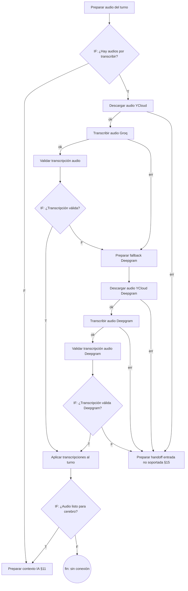

| Nodo | Tipo | Qué hace | Recibe de | Envía a |
|---|---|---|---|---|
| Preparar audio del turno | Code | Busca audios `[MEDIA_PENDIENTE]` del turno, revalida MIME y enlace YCloud, limita cantidad y emite un item por audio (`transcribir_audio`). Lee además: Resolver turno conversacional | IF: ¿Hay imágenes…? [F] · IF Groq/DeepSeek/OpenAI válido [T] | IF: ¿Hay audios por transcribir? |
| IF: ¿Hay audios por transcribir? | IF `transcribir_audio` | | Preparar audio del turno | [T] Descargar audio YCloud · [F] Preparar contexto IA |
| Descargar audio YCloud | HTTP GET `media_link` (Header Auth) | Descarga el audio | IF [T] | [ok] Transcribir audio Groq · [err] Preparar handoff entrada no soportada |
| Transcribir audio Groq | HTTP POST `api.groq.com/openai/v1/audio/transcriptions` (multipart, `whisper-large-v3-turbo`, `es`) | Speech-to-text principal | Descargar audio YCloud [ok] | [ok] Validar transcripción audio · [err] Preparar fallback Deepgram |
| Validar transcripción audio | Code | Detecta el proveedor (Groq o Deepgram), empareja por posición con el audio original y emite `transcripcion_valida`. No lanza error si falla. Lee además: Preparar audio del turno | Transcribir audio Groq | IF: ¿Transcripción válida? |
| IF: ¿Transcripción válida? | IF `transcripcion_valida` | | Validar transcripción audio | [T] Aplicar transcripciones al turno · [F] Preparar fallback Deepgram |
| Preparar fallback Deepgram | Code | Recupera la metadata de los audios fallidos y prepara de nuevo `media_link` para volver a descargarlos. Lee además: Preparar audio del turno | Transcribir audio Groq [err] · IF: ¿Transcripción válida? [F] | Descargar audio YCloud Deepgram |
| Descargar audio YCloud Deepgram | HTTP GET `media_link` (Header Auth) | Segunda descarga para Deepgram | Preparar fallback Deepgram | [ok] Transcribir audio Deepgram · [err] Preparar handoff entrada no soportada |
| Transcribir audio Deepgram | HTTP POST `api.deepgram.com/v1/listen` (`nova-3`, `es`, binario) | Speech-to-text de respaldo | Descargar audio YCloud Deepgram [ok] | [ok] Validar transcripción audio Deepgram · [err] Preparar handoff entrada no soportada |
| Validar transcripción audio Deepgram | Code | Misma lógica que "Validar transcripción audio" (duplicada) | Transcribir audio Deepgram | IF: ¿Transcripción válida Deepgram? |
| IF: ¿Transcripción válida Deepgram? | IF `transcripcion_valida` | | Validar transcripción audio Deepgram | [T] Aplicar transcripciones al turno · [F] Preparar handoff entrada no soportada |
| Aplicar transcripciones al turno | Code | Sustituye `[MEDIA_PENDIENTE]` de cada audio por su transcripción, limpia URLs/metadatos, mantiene el orden y emite **un solo item**. Lee además: Resolver turno conversacional, Preparar audio del turno | IF: ¿Transcripción válida? [T] · IF Deepgram [T] | IF: ¿Audio listo para cerebro? |
| IF: ¿Audio listo para cerebro? | IF `audio_listo_para_cerebro` | | Aplicar transcripciones al turno | [T] Preparar contexto IA · [F] **sin conexión (fin)** |

---

## 11. Cerebro comercial

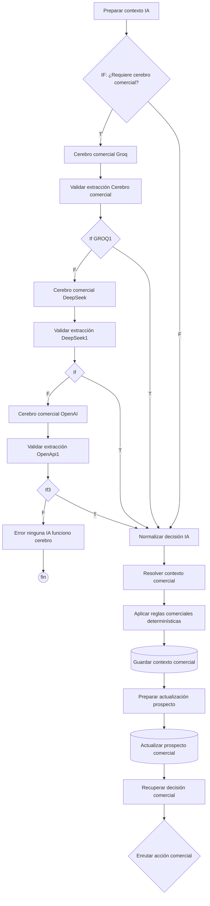

| Nodo | Tipo | Qué hace | Recibe de | Envía a |
|---|---|---|---|---|
| Preparar contexto IA | Code | Construye el contexto final del cerebro: identidad y memoria comercial (de Preparar conversación), turno enriquecido (audios transcritos, análisis de imagen válido, medidas detectadas en imágenes) e historial (sin marcadores internos: respuesta omitida y `[BOT REACTIVADO POR ADMINISTRADOR]`). Expone `ultimo_saliente` (origen BOT / AUTOMATICO / HUMANO, `accion_equivalente`, `posterior_al_turno`) y `medidas_ya_solicitadas`. Reglas pre-IA solo para texto sin multimedia: `SALUDO_SIMPLE` (todas las palabras son de saludo; respuesta fija "Buenas tardes 🤗 ¿En qué podemos ayudarle?" según el saludo del cliente o la hora de Ecuador) y `PRODUCTO_NO_P4` (tarjetas de presentación, flyers/volantes, carpetas, talonarios, boletos, entradas, formularios, hojas membretadas, trípticos, afiches, brochures, sin mencionar etiquetas/stickers/adhesivos) y `DIVISION_MINIMO_DISENOS` (el cliente quiere repartir una cantidad entre varios diseños, sabores, nombres, modelos, marcas o productos con menos de 1000 por diseño o cantidades por diseño que no son múltiplo de 1000: `INFORMAR_MINIMO` sin derivar, con respuesta determinística que explica el mínimo, cuánto necesitaría y para cuántos diseños alcanza; expone `division_disenos`). Si una regla aplica emite `decision` con el contrato del cerebro y `requiere_cerebro_comercial = false`. Lee además: Preparar conversación, Resolver turno conversacional, Recuperar historial conversación | IF: ¿Hay audios…? [F] · IF: ¿Audio listo para cerebro? [T] | IF: ¿Requiere cerebro comercial? |
| IF: ¿Requiere cerebro comercial? | IF `requiere_cerebro_comercial !== false` | Salta los tres proveedores de IA cuando una regla pre-IA ya decidió | Preparar contexto IA | [T] Cerebro comercial Groq · [F] Normalizar decisión IA |
| Cerebro comercial Groq | Information Extractor (modelo: Groq Chat Model1; schema manual) | Interpreta la conversación y decide intención, acción, datos de cotización, clasificación y respuesta sugerida. El prompt (idéntico en los tres proveedores) le pide razonar sobre lo que el cliente pide ahora antes de cotizar (§5.1: no recotizar sin datos nuevos, "otras medidas" → pedir medidas, ml/gramos no son cantidad) y define el diseño: Pegaso es productor de impresión, replica un ejemplo con el logo del cliente y no crea logos ni marcas (§27, CASOS A, B y E) | IF: ¿Requiere cerebro comercial? [T] | Validar extracción Cerebro comercial |
| Validar extracción Cerebro comercial | Code | Valida el contrato del cerebro: enums, tipos, respuesta sugerida (tono, anti-repetición), cotización P4, medidas no producibles (lado ≤ 1 cm), derivación, clasificación A/B/C, motivo y notificación. Emite `valid`. Lee además: Preparar contexto IA | Cerebro comercial Groq | If GROQ1 |
| If GROQ1 | IF `valid` | | Validar extracción Cerebro comercial | [T] Normalizar decisión IA · [F] Cerebro comercial DeepSeek |
| Cerebro comercial DeepSeek | Information Extractor (modelo: DeepSeek Chat Model1) | Mismo prompt con DeepSeek | If GROQ1 [F] | Validar extracción DeepSeek1 |
| Validar extracción DeepSeek1 | Code | Misma validación (copia del validador del cerebro). Lee además: Preparar contexto IA | Cerebro comercial DeepSeek | If |
| If | IF `valid` | | Validar extracción DeepSeek1 | [T] Normalizar decisión IA · [F] Cerebro comercial OpenAI |
| Cerebro comercial OpenAI | Information Extractor (modelo: OpenAI Chat Model1) | Mismo prompt con OpenAI | If [F] | Validar extracción OpenApi1 |
| Validar extracción OpenApi1 | Code | Misma validación (copia). Lee además: Preparar contexto IA | Cerebro comercial OpenAI | If3 |
| If3 | IF `valid` | | Validar extracción OpenApi1 | [T] Normalizar decisión IA · [F] Error ninguna IA funciono cerebro |
| Error ninguna IA funciono cerebro | Code | Devuelve `ALL_AI_FAILED` | If3 [F] | — (**fin**, el cliente no recibe respuesta) |
| Normalizar decisión IA | Code | Convierte la decisión validada (de cualquier proveedor) en un contrato único, la une al contexto (ids, prospecto, actor, contexto comercial), resuelve ciudad/provincia y aplica evidencia multimedia (comprobante → `REPORTAR_PAGO` + `DERIVAR_HUMANO`; imagen/archivo que requiere revisión → `DERIVAR_HUMANO`). Acepta la `decision` de la regla pre-IA (`input.decision`). Lee además: Preparar contexto IA | If GROQ1 [T] · If [T] · If3 [T] · IF: ¿Requiere cerebro comercial? [F] | Resolver contexto comercial |
| Resolver contexto comercial | Code | Consolida datos nuevos con el contexto persistido: medidas como par atómico, forma derivada, cantidad por defecto 1000 si hay medidas (no se pregunta cantidad), detecta cambios reales para recotizar, resuelve la acción final (humano siempre se respeta; acciones informativas se preservan). Si la cantidad cotizable es **≥ 6000** fuerza `DERIVAR_HUMANO` (`motivo_derivacion = COTIZACION_ESPECIAL`, `regla_derivacion = CANTIDAD_MAYORISTA`) antes de `COTIZAR_P4`. `PRODUCTO_NO_P4` → `DERIVAR_HUMANO` (`COTIZACION_ESPECIAL`, `regla_derivacion = PRODUCTO_NO_P4`, guarda `contexto_comercial.producto_no_p4`). Fecha pedida por el cliente ("para el 15", "para el viernes", "15 de octubre", "lo necesito para…"; "para 5 diseños / sabores / nombres…" no cuenta como fecha) o respuesta de IA que promete fecha → responde la metodología semanal (pedidos lunes a miércoles, producción miércoles y jueves, entregas viernes desde las 17:00) y guarda `contexto_comercial.fecha_deseada_cliente`; nunca confirma la fecha. `PEDIR_MEDIDAS` con medidas ya solicitadas → "Gracias. Para cotizar sus etiquetas solo nos falta …" si el turno aporta datos, u `omitir_envio` si no. `omitir_envio` también cuando un eco automático posterior al inicio del turno ya cubrió la misma acción; si ese eco respondió una pregunta informativa (material, precio, ubicación…) y aún faltan medidas no pedidas, en vez de omitir envía solo "¿En qué medidas necesita sus etiquetas?…" (`seguimiento_tras_automatizacion`). **Verificación de números del turno** (texto sin multimedia ni números en palabras): la cantidad y las medidas que la IA atribuye al mensaje actual deben estar escritas en él; "500 ml", "250 g", "1 litro" no son cantidad (`datos_descartados_turno`). **No recotizar sin un cambio real** (`ajuste_recotizacion`): si la IA pide `COTIZAR_P4` sin datos nuevos, "otras medidas" → `PEDIR_MEDIDAS` ("Indíquenos por favor las nuevas medidas…"); sesión nueva (sin mensajes en 24 h) sin referirse a lo anterior → `PEDIR_MEDIDAS` si pregunta precio o `RESPONDER_GENERAL`; cotización vigente sin pedir precio → `RESPONDER_GENERAL`. **Imágenes informativas:** si la respuesta sí se envía y es de material (`INFORMAR_MATERIAL` → fila `IMAGEN_MATERIAL`) o de metodología de producción (`INFORMAR_ENTREGA`, `INFORMAR_METODOLOGIA` o fecha pedida respondida con la metodología → fila `IMAGEN_METODOLOGIA`), y esa fila de `configuracion_bot` tiene `activo = true` y un `url` https, y la conversación no recibió antes esa imagen, emite `enviar_imagen_informativa`, `imagen_informativa` e `imagen_informativa_url` y guarda `contexto_comercial.imagen_material` o `contexto_comercial.imagen_metodologia` (`url`, `enviada_at`): una vez por conversación y por imagen. Lee además: Preparar contexto IA, Obtener configuración MODO_PRUEBA | Normalizar decisión IA | Aplicar reglas comerciales determinísticas |
| Aplicar reglas comerciales determinísticas | Code | Reglas objetivas con prioridad sobre la IA (medida mínima: lado ≤ 1 cm no producible; limpia restricciones previas si la nueva medida es válida). Conserva todo el contrato | Resolver contexto comercial | Guardar contexto comercial |
| Guardar contexto comercial | Postgres update `conversaciones` | Persiste `contexto_comercial` y `ultimo_mensaje_at` | Aplicar reglas… | Preparar actualización prospecto |
| Preparar actualización prospecto | Code | Prepara los campos de `prospectos` (producto de interés, ciudad, provincia, intención, acción, estado) conservando valores previos si no hay nuevos. Toma la decisión de `Resolver contexto comercial` (su entrada es solo la fila del UPDATE). No persiste `requiere_humano`. Lee además: Resolver contexto comercial | Guardar contexto comercial | Actualizar prospecto comercial |
| Actualizar prospecto comercial | Postgres update `prospectos` | Persiste esos campos (sin `requiere_humano`: esa bandera solo la levantan las rutas de derivación e intervención humana) | Preparar actualización prospecto | Recuperar decisión comercial |
| Recuperar decisión comercial | Code | Recupera el contrato definitivo de "Resolver contexto comercial" (el UPDATE solo devuelve la fila). Lee además: Resolver contexto comercial | Actualizar prospecto comercial | Enrutar acción comercial |
| Enrutar acción comercial | Switch (por `accion`, 20 reglas + salida *fallback*) | Distribuye según la acción decidida | Recuperar decisión comercial | Ver tabla siguiente |

### Salidas de "Enrutar acción comercial"

| Salida | `accion` | Destino |
|---|---|---|
| 0 | `COTIZAR_P4` | Extractor → Groq Chat Model (§13) |
| 1–12 | `PEDIR_MEDIDAS`, `PEDIR_CANTIDAD`, `PEDIR_PRODUCTO`, `PEDIR_FORMA`, `RESPONDER_GENERAL`, `INFORMAR_MATERIAL`, `INFORMAR_MINIMO`, `INFORMAR_UBICACION`, `INFORMAR_METODOLOGIA`, `INFORMAR_METODOLOGIA_PAGO`, `INFORMAR_ENTREGA`, `INFORMAR_DISENO` | Preparar respuesta comercial (§12) |
| 13, 14 | `REGISTRAR_ACEPTACION` (regla duplicada) | **sin conexión** |
| 15 | `ENVIAR_DATOS_PAGO` | **sin conexión** |
| 16 | `VALIDAR_ABONO` | **sin conexión** |
| 17, 18 | `RESPONDER_NO_PRODUCIBLE`, `MEDIDA_NO_PRODUCIBLE` | Preparar respuesta comercial |
| 19 | `DERIVAR_HUMANO` | Preparar derivación humana (§15) |
| 20 | *fallback* (cualquier otra acción) | Preparar respuesta comercial |

Algunas claves de salida tienen un espacio final en el nombre (`PEDIR_PRODUCTO `, `PEDIR_FORMA `, `INFORMAR_DISENO `); solo afecta a la etiqueta, no a la comparación.

---

## 12. Respuesta comercial (acciones sin cotización)

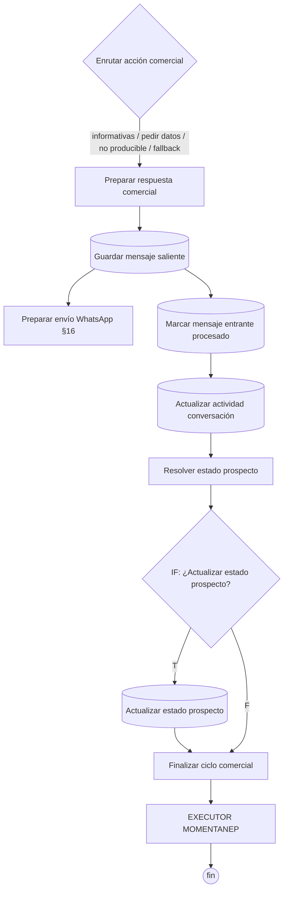

| Nodo | Tipo | Qué hace | Recibe de | Envía a |
|---|---|---|---|---|
| Preparar respuesta comercial | Code | Toma la respuesta decidida. Si la decisión trae `omitir_envio` o la respuesta es idéntica al último saliente (de `Preparar contexto IA`), `respuesta_final` queda como marcador `[RESPUESTA AUTOMÁTICA OMITIDA · motivo=...]`: se guarda como SALIENTE (cierra el turno) pero no se envía. Lee además: Preparar contexto IA | Enrutar acción comercial (salidas 1–12, 17, 18, 20) | Guardar mensaje saliente |
| Guardar mensaje saliente | Postgres insert `mensajes` | Guarda la respuesta SALIENTE | Preparar respuesta comercial | Marcar mensaje entrante procesado **y** Preparar envío WhatsApp (en paralelo) |
| Marcar mensaje entrante procesado | Postgres update `mensajes` (por `mensaje_externo_id`) | `procesado = true` | Guardar mensaje saliente | Actualizar actividad conversación |
| Actualizar actividad conversación | Postgres update `conversaciones` | `ultimo_mensaje_at` | Marcar mensaje entrante procesado | Resolver estado prospecto |
| Resolver estado prospecto | Code | Resuelve el estado **comercial** del prospecto (no el de la conversación). Solo hace la transición `NUEVO → EN_CONVERSACION`. Lee además: Recuperar decisión comercial, Actualizar prospecto comercial | Actualizar actividad conversación | IF: ¿Actualizar estado prospecto? |
| IF: ¿Actualizar estado prospecto? | IF `actualizar_estado_prospecto` | | Resolver estado prospecto | [T] Actualizar estado prospecto · [F] Finalizar ciclo comercial |
| Actualizar estado prospecto | Postgres update `prospectos` | `estado`, `actualizado_at` | IF [T] | Finalizar ciclo comercial |
| Finalizar ciclo comercial | Code | Marcador de fin del ciclo | IF [F] · Actualizar estado prospecto | EXECUTOR MOMENTANEP |
| EXECUTOR MOMENTANEP | Code | Marcador temporal "LLEGO AL FINAL." | Finalizar ciclo comercial | — (**fin**) |

---

## 13. Cotización

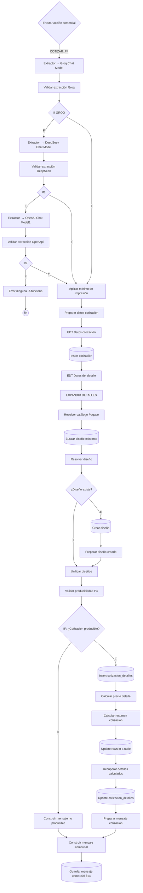

| Nodo | Tipo | Qué hace | Recibe de | Envía a |
|---|---|---|---|---|
| Extractor → Groq Chat Model | Information Extractor (modelo: Groq Chat Model; schema manual) | Convierte el requerimiento en `{ detalles: [...] }` (cantidad, medidas, forma, material…). No conversa | Enrutar acción comercial (0) | Validar extracción Groq |
| Validar extracción Groq | Code | Valida el contrato del extractor: cantidades < 1000, dimensiones inválidas, contradicciones forma/medidas, menos detalles que medidas pedidas, alucinaciones evidentes. No calcula ni corrige. Lee además: Resolver contexto comercial | Extractor → Groq | If GROQ |
| If GROQ | IF `valid` | | Validar extracción Groq | [T] Aplicar mínimo de impresión · [F] Extractor  → DeepSeek Chat Model |
| Extractor  → DeepSeek Chat Model | Information Extractor (modelo: DeepSeek Chat Model) | Mismo extractor con DeepSeek | If GROQ [F] | Validar extracción DeepSeek |
| Validar extracción DeepSeek | Code | Misma validación (copia) | Extractor → DeepSeek | If1 |
| If1 | IF `valid` | | Validar extracción DeepSeek | [T] Aplicar mínimo de impresión · [F] Extractor  → OpenAI Chat Model1 |
| Extractor  → OpenAI Chat Model1 | Information Extractor (modelo: OpenAI Chat Model) | Mismo extractor con OpenAI | If1 [F] | Validar extracción OpenApi |
| Validar extracción OpenApi | Code | Misma validación (copia) | Extractor → OpenAI | If2 |
| If2 | IF `valid` | | Validar extracción OpenApi | [T] Aplicar mínimo de impresión · [F] Error ninguna IA funciono |
| Error ninguna IA funciono | Code | Devuelve `ALL_AI_FAILED` | If2 [F] | — (**fin**, el cliente no recibe respuesta) |
| Aplicar mínimo de impresión | Code | Sin cantidad → 1000; redondea a mínimo 1000 y múltiplos de 1000. Si algún detalle queda en ≥ 6000 lanza error antes de cualquier INSERT (red de seguridad; la derivación normal ocurre en Resolver contexto comercial) | If GROQ [T] · If1 [T] · If2 [T] | Preparar datos cotización |
| Preparar datos cotización | Code | Valida y normaliza los detalles para P4 (producto y material no obligatorios; requiere cantidad + ancho + alto) | Aplicar mínimo de impresión | EDT Datos cotización |
| EDT Datos cotización | Set (raw) | Arma la cabecera: `cliente_id: 1`, `contacto_id: 1` (**fijos**), `estado: PENDIENTE`, `detalles` | Preparar datos cotización | Insert cotización |
| Insert cotización | Postgres insert `cotizaciones` | Crea la cotización | EDT Datos cotización | EDT Datos del detalle |
| EDT Datos del detalle | Set (raw) | `cotizacion_id`, `cliente_id` y los detalles de "Preparar datos cotización" | Insert cotización | EXPANDIR DETALLES |
| EXPANDIR DETALLES | Code | Un item por detalle; genera nombre técnico si falta (p. ej. "Etiqueta 5x5 cm circular"). Lee además: Preparar datos cotización | EDT Datos del detalle | Resolver catálogo Pegaso |
| Resolver catálogo Pegaso | Code | Resuelve `producto_id` (trabajo gráfico de Pegaso, no el producto del cliente) y `material_id` (por defecto P4); marca cotización manual si no es P4 | EXPANDIR DETALLES | Buscar diseño existente |
| Buscar diseño existente | Postgres select `disenos` (una vez) | Diseños activos del cliente | Resolver catálogo Pegaso | Resolver diseño |
| Resolver diseño | Code | Por cada detalle, busca un diseño idéntico (`diseno_existente`, `diseno_id`). Lee además: Resolver catálogo Pegaso | Buscar diseño existente | ¿Diseño existe? |
| ¿Diseño existe? | IF `diseno_existente` | | Resolver diseño | [T] Unificar diseños · [F] Crear diseño |
| Crear diseño | Postgres insert `disenos` | Nuevo diseño (cliente, material, nombre, medidas, forma, versión) | ¿Diseño existe? [F] | Preparar diseño creado |
| Preparar diseño creado | Code | Empareja cada diseño creado con su detalle original. Lee además: ¿Diseño existe? | Crear diseño | Unificar diseños (entrada 2) |
| Unificar diseños | Merge (append) | Reúne detalles con diseño existente y creado | ¿Diseño existe? [T] · Preparar diseño creado | Validar producibilidad P4 |
| Validar producibilidad P4 | Code | Antes de guardar o calcular: ningún lado ≤ 1 cm; datos completos. Emite `cotizacion_producible` | Unificar diseños | IF: ¿Cotización producible? |
| IF: ¿Cotización producible? | IF `cotizacion_producible` | | Validar producibilidad P4 | [T] Insert cotizacion_detalles · [F] Construir mensaje no producible |
| Construir mensaje no producible | Code | Mensaje explicando la restricción de medida y pidiendo otra | IF [F] | Construir mensaje comercial |
| Insert cotizacion_detalles | Postgres insert `cotizacion_detalles` | Guarda cada detalle (producto, material, diseño, medidas, forma, cantidad…) | IF [T] | Calcular precio detalle |
| Calcular precio detalle | Code | **Fuente única de las reglas de precio** (V2.6: medida mínima 2 cm; banda pequeña $18 y 4x4 $20 con precio fijo; +1 cm por 5x5 y por forma especial; factor por rango de cantidad 1000–2000 = 0.75 y 3000–5000 = 0.67; tamaño grande = precio por 1000 con el factor del rango > $130 → 0.67; `Math.ceil`; precio mínimo absoluto de $18 por detalle). Desde 6000 no hay precio automático (lanza error). Emite `mejora_precio_desde_cantidad`. Lee además: EXPANDIR DETALLES | Insert cotizacion_detalles | Calcular resumen cotización |
| Calcular resumen cotización | Code | Suma totales de los detalles (subtotal, IVA interno, total, descuentos); valida que todos pertenezcan a la misma cotización | Calcular precio detalle | Update rows in a table |
| Update rows in a table | Postgres update `cotizaciones` | `subtotal`, `iva`, `total` | Calcular resumen cotización | Recuperar detalles calculados |
| Recuperar detalles calculados | Code | Recupera los items de "Calcular precio detalle" (el UPDATE solo devuelve la cabecera) | Update rows in a table | Update cotizacion_detalles |
| Update cotizacion_detalles | Postgres update `cotizacion_detalles` | `precio_unitario`, `precio_total`, `requiere_cotizacion_manual` | Recuperar detalles calculados | Preparar mensaje cotización |
| Preparar mensaje cotización | Code | Mensaje final de precio con reglas de presentación (sin "Total" ni "IVA incluido", cierre variable sin IA según las cotizaciones en los últimos 6 salientes: 1ª pide el diseño, 2ª ofrece otra medida, 3ª "Verifíquele por favor.", 4ª "Veo que estamos comparando varias alternativas…" una sola vez, siguientes "Verifíquele a detalle por favor."). Si un detalle supera el mínimo de su rango de cantidad y el calculador indica mejora real en el siguiente rango, añade "A partir de 3.000 etiquetas podemos mejorarle el precio." Lee además: Update rows in a table, Recuperar detalles calculados, Recuperar decisión comercial, Preparar contexto IA | Update cotizacion_detalles | Construir mensaje comercial |
| Construir mensaje comercial | Code | **Punto único de salida** de las respuestas de cotización (producible o no): valida el mensaje principal, recupera identidad y arma `mensaje_comercial` / `mensajes_comerciales`. Lee además: Recuperar decisión comercial | Construir mensaje no producible · Preparar mensaje cotización | Guardar mensaje comercial |

---

## 14. Post-cotización

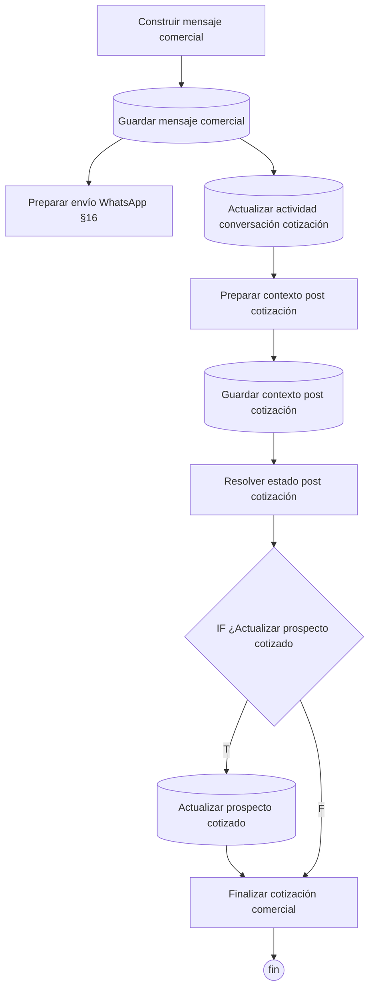

| Nodo | Tipo | Qué hace | Recibe de | Envía a |
|---|---|---|---|---|
| Guardar mensaje comercial | Postgres insert `mensajes` | Guarda la respuesta de cotización (SALIENTE) | Construir mensaje comercial | Actualizar actividad conversación cotización **y** Preparar envío WhatsApp (en paralelo) |
| Actualizar actividad conversación cotización | Postgres update `conversaciones` | `ultimo_mensaje_at` | Guardar mensaje comercial | Preparar contexto post cotización |
| Preparar contexto post cotización | Code | Actualiza `contexto_comercial` según el resultado (producible o no producible); no asume que todas las ramas se ejecutaron. Lee además: Recuperar decisión comercial, Resolver contexto comercial, Preparar mensaje cotización, Construir mensaje no producible, Guardar mensaje comercial | Actualizar actividad conversación cotización | Guardar contexto post cotización |
| Guardar contexto post cotización | Postgres update `conversaciones` | Persiste `contexto_comercial` | Preparar contexto post cotización | Resolver estado post cotización |
| Resolver estado post cotización | Code | Si es prospecto y se cotizó, lo pasa a `COTIZADO`. Lee además: Preparar contexto post cotización | Guardar contexto post cotización | IF ¿Actualizar prospecto cotizado |
| IF ¿Actualizar prospecto cotizado | IF `actualizar_estado_prospecto` | | Resolver estado post cotización | [T] Actualizar prospecto cotizado · [F] Finalizar cotización comercial |
| Actualizar prospecto cotizado | Postgres update `prospectos` | `estado`, `ultima_intencion`, `ultima_accion` | IF [T] | Finalizar cotización comercial |
| Finalizar cotización comercial | Code (`onError: continue`) | Cierra el flujo de cotización; distingue cotización producible (con `cotizacion_id` y total) de no producible (no es error). Lee además: Resolver estado post cotización | IF [F] · Actualizar prospecto cotizado | — (**fin**) |

---

## 15. Derivación humana (handoff) y notificación

Tres caminos llegan a la misma ruta estándar de handoff: la decisión `DERIVAR_HUMANO` del cerebro, el fallo total del análisis de imagen y las entradas no soportadas o audios no transcribibles.

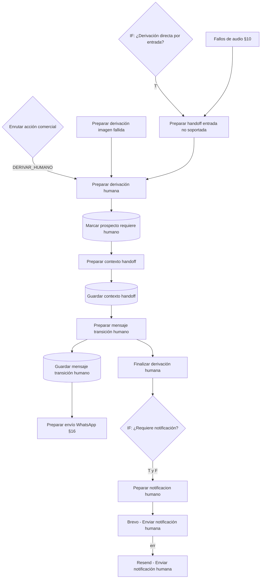

| Nodo | Tipo | Qué hace | Recibe de | Envía a |
|---|---|---|---|---|
| Preparar handoff entrada no soportada | Code | Contrato de handoff directo para entradas no procesables (video, documento, sticker, ubicación…) o audios cuya transcripción falló en Groq y Deepgram. Lee además: Resolver turno conversacional, Preparar audio del turno, Preparar entrada WhatsApp, Normalizar mensaje, Preparar conversación | IF: ¿Derivación directa por entrada? [T] · Descargar audio YCloud [err] · Transcribir audio Deepgram [err] · Descargar audio YCloud Deepgram [err] · IF: ¿Transcripción válida Deepgram? [F] | Preparar derivación humana |
| Preparar derivación humana | Code | Convierte la decisión en un contrato estable de HANDOFF: valida ids, decide motivo, clasificación, prioridad (IA + reglas ALTA/MEDIA) y si requiere notificación; separa el mensaje original del cliente del mensaje de transición. Lee además: Recuperar decisión comercial | Enrutar acción comercial (19) · Preparar derivación imagen fallida · Preparar handoff entrada no soportada | Marcar prospecto requiere humano |
| Marcar prospecto requiere humano | Postgres update `prospectos` | `requiere_humano`, `ultima_accion`, `actualizado_at` | Preparar derivación humana | Preparar contexto handoff |
| Preparar contexto handoff | Code | Recupera el contrato de handoff (el UPDATE solo devuelve el prospecto) y arma el nuevo `contexto_comercial`. Lee además: Preparar derivación humana | Marcar prospecto requiere humano | Guardar contexto handoff |
| Guardar contexto handoff | Postgres update `conversaciones` | `contexto_comercial`, `ultimo_mensaje_at` | Preparar contexto handoff | Preparar mensaje transición humano |
| Preparar mensaje transición humano | Code | Elige el texto fijo de transición según el motivo (pago, comprobante, pedido, llamada, imagen, archivo, negociación, reclamo) con fallback por intención; `tipo_mensaje_salida = HANDOFF_HUMANO`. Lee además: Preparar contexto handoff | Guardar contexto handoff | Guardar mensaje transición humano **y** Finalizar derivación humana (en paralelo) |
| Guardar mensaje transición humano | Postgres insert `mensajes` | Guarda el mensaje de transición (SALIENTE) | Preparar mensaje transición humano | Preparar envío WhatsApp |
| Finalizar derivación humana | Code | Contrato final del handoff (no cambia decisiones ni prioridad). Lee además: Preparar mensaje transición humano | Preparar mensaje transición humano | IF: ¿Requiere notificación? |
| IF: ¿Requiere notificación? | IF `requiere_notificacion` | **Ambas salidas van al mismo nodo** (ver §18) | Finalizar derivación humana | [T] y [F] Peparar notificacion humano |
| Peparar notificacion humano | Code | Notificación interna: categoría (`INTERESADO_PAGO`, `PAGO_REPORTADO`, `SOLICITA_CONTACTO`, `ARCHIVO_REQUIERE_REVISION`, `NEGOCIACION`, `RECLAMO`, `REVISION_GENERAL`), prioridad, asunto, texto y HTML del email | IF: ¿Requiere notificación? | Brevo - Enviar notificación humana |
| Brevo - Enviar notificación humana | HTTP POST `api.brevo.com/v3/smtp/email` (credencial Header Auth; `onError: continueErrorOutput`) | Envía el email interno | Peparar notificacion humano | [ok] **fin** · [err] Resend - Enviar notificación humana |
| Resend - Enviar notificación humana | HTTP POST `api.resend.com/emails` (credencial Header Auth; `onError: continueRegularOutput`) | Respaldo de email si Brevo falla | Brevo [err] | — (**fin**) |

---

## 16. Salida WhatsApp

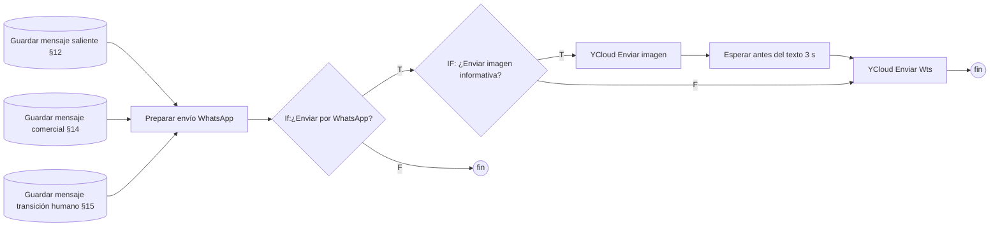

| Nodo | Tipo | Qué hace | Recibe de | Envía a |
|---|---|---|---|---|
| Preparar envío WhatsApp | Code | Punto único de envío. Resuelve el texto (prioriza el contenido persistido), el teléfono destino, confirma que la ejecución nació de un WhatsApp real (evita envíos en TEST/manual), resuelve proveedor YCloud y número emisor, y construye `ycloud_request`. Si `Recuperar decisión comercial` trae `enviar_imagen_informativa` y el texto se envía, emite `enviar_imagen`, `imagen_informativa` (`MATERIAL` o `METODOLOGIA`) y `ycloud_request_imagen`. Emite `enviar_whatsapp`; nunca envía el marcador de respuesta omitida (`motivo_no_envio = RESPUESTA_OMITIDA_DUPLICADA`). Recupera contexto de las tres rutas con lectura segura (`{}` si un nodo no participó) | Guardar mensaje saliente · Guardar mensaje comercial · Guardar mensaje transición humano | If:¿Enviar por WhatsApp? |
| If:¿Enviar por WhatsApp? | IF `enviar_whatsapp` | | Preparar envío WhatsApp | [T] IF: ¿Enviar imagen informativa? · [F] **fin** |
| IF: ¿Enviar imagen informativa? | IF `$('Preparar envío WhatsApp').first().json.enviar_imagen === true` | Pasa cuando la respuesta lleva imagen de material o de metodología (ver `Resolver contexto comercial`, §11) | If:¿Enviar por WhatsApp? [T] | [T] YCloud Enviar imagen · [F] YCloud Enviar Wts |
| YCloud Enviar imagen | HTTP POST `api.ycloud.com/v2/whatsapp/messages` (misma credencial), **continúa ante error** | Envía la imagen antes del texto (`ycloud_request_imagen.body`: `type = image`, `image.link`). Si falla, el flujo sigue y el texto se envía igual | IF [T] | Esperar antes del texto |
| Esperar antes del texto | Wait 3 segundos | Da tiempo a que WhatsApp entregue la imagen antes que el texto (la imagen tarda más en procesarse) | YCloud Enviar imagen | YCloud Enviar Wts |
| YCloud Enviar Wts | HTTP POST `api.ycloud.com/v2/whatsapp/messages` (credencial Header Auth) | Envía el texto al cliente. Toma el body de `$('Preparar envío WhatsApp').first().json.ycloud_request.body`, porque su entrada puede ser la respuesta de la imagen | IF imagen [F] · Esperar antes del texto | — (**fin**) |

---

## 17. Sub-nodos de IA, nodos aislados y puntos finales

### Modelos y parsers (conexiones `ai_languageModel` / `ai_outputParser`)

| Sub-nodo | Tipo | Modelo / schema | Conectado a |
|---|---|---|---|
| Groq Chat Model | Groq Chat | `openai/gpt-oss-20b`, temperatura 0 | Extractor → Groq Chat Model |
| DeepSeek Chat Model | DeepSeek Chat | `deepseek-flash` | Extractor  → DeepSeek Chat Model |
| OpenAI Chat Model | OpenAI Chat | `gpt-5-mini` | Extractor  → OpenAI Chat Model1 |
| Groq Chat Model1 | Groq Chat | `openai/gpt-oss-20b`, temperatura 0 | Cerebro comercial Groq |
| DeepSeek Chat Model1 | DeepSeek Chat | `deepseek-flash` | Cerebro comercial DeepSeek |
| OpenAI Chat Model1 | OpenAI Chat | `gpt-5-mini` | Cerebro comercial OpenAI |
| Groq Chat Model2 | Groq Chat | `qwen/qwen3.8-27b` | Analizar imagen Groq Basic LLM |
| Analizar imagen DeepSeek | DeepSeek Chat (es un **modelo**, no un análisis) | `deepseek-flash` | Analizar imagen DeepSeek1 |
| OpenAI Chat | OpenAI Chat | `gpt-5.6-luna` | Analizar imagen Open IA |
| Schema análisis imagen / 1 / 2 | Structured Output Parser (schema manual) | Contrato del análisis visual (`contenido_detectado`, …) | Analizar imagen Groq Basic LLM / DeepSeek1 / Open IA |

### Nodos aislados (sin conexiones de flujo)

| Nodo | Tipo | Observación |
|---|---|---|
| Webhook Post | Webhook `POST /whatsapp-meta` | Entrada directa de Meta Cloud API desconectada. Hoy los mensajes entran por YCloud |
| Respond to Webhook Post | Respond to Webhook (`200 EVENT_RECEIVED`) | Respuesta del webhook anterior, sin uso |
| Enviar WhatsApp Cloud API1 | HTTP POST Graph API `/{phone_number_id}/messages` | Envío directo por Meta, sin uso (se envía por YCloud) |
| Execute a SQL query | Postgres (SQL) | `UPDATE configuracion_bot` que activa MODO_PRUEBA con una lista fija de teléfonos. Utilidad manual |

### Dónde termina cada ejecución

| Punto final | Situación |
|---|---|
| Responder challenge Meta / Rechazar verificación Meta | Verificación del webhook de Meta |
| Actualizar configuración MODO_PRUEBA | Comando STOP/START de administrador |
| Reactivar bot prospecto | Comando ACTIVEBOT de administrador |
| Actualizar conversación por intervención humana | Mensaje de un humano de Pegaso registrado |
| If: ¿Evento WhatsApp procesable? [F] | Evento que no es un mensaje |
| ¿Cliente existente? [T] | Cliente registrado (sin rama implementada) |
| Finalizar mensaje modo prueba | Teléfono no autorizado con MODO_PRUEBA activo |
| Finalizar mensaje atención humana | Prospecto ya atendido por humano |
| IF: ¿Procesar turno? [F] | Llegó otro mensaje durante la espera (lo atiende la ejecución más reciente) o un humano de Pegaso escribió hace menos de 10 minutos (`ATENCION_HUMANA`) |
| IF: ¿Audio listo para cerebro? [F] | Sin conexión |
| Error ninguna IA funciono cerebro / Error ninguna IA funciono | Fallaron los 3 proveedores (sin respuesta al cliente) |
| Enrutar acción comercial salidas 13–16 | `REGISTRAR_ACEPTACION`, `ENVIAR_DATOS_PAGO`, `VALIDAR_ABONO` (sin respuesta) |
| EXECUTOR MOMENTANEP | Fin de respuesta comercial |
| Finalizar cotización comercial | Fin de cotización |
| Brevo (ok) / Resend | Fin de notificación interna |
| YCloud Enviar Wts / If:¿Enviar por WhatsApp? [F] | Fin del envío al cliente (incluye respuestas omitidas por duplicado) |

### Mantener este documento

Al crear, renombrar, conectar o eliminar un nodo, actualiza la ficha de su etapa, el diagrama Mermaid y, si cambia un final de ejecución, la tabla anterior. Si renombras un nodo, busca su nombre en las columnas "Lee además".

---

## 18. Observaciones y posibles problemas

Detectados al documentar. Son hechos del workflow actual; **no se ha cambiado nada**. Verificar con ejecuciones reales antes de corregir.

1. **`IF: ¿Derivación directa por entrada?` evalúa `$json.puede_responder_bot`.** Su entrada es la fila devuelta por `Guardar mensaje entrante` y ese campo se crea más tarde, en `Resolver permiso automatización`. `Preparar entrada no soportada` marca `requiere_humano_entrada`, no `puede_responder_bot`. Probablemente la rama *true* (handoff directo de entradas no soportadas) nunca se ejecuta y esas entradas siguen hacia el cerebro comercial.
2. **`¿Cliente existente?` [T] no está conectado**: si el teléfono pertenece a un cliente registrado en `contactos`, la ejecución termina sin guardar el mensaje ni responder. Conectarlo a la ruta de prospectos haría que el bot conteste a clientes (incluidas cotizaciones automáticas) y que la intervención humana, que busca por `prospectos`, no los encuentre: el eco humano no levantaría la bandera ni se registraría. Requiere decidir antes qué debe hacer el bot con clientes.
3. **`Enrutar acción comercial`**: las acciones `REGISTRAR_ACEPTACION` (regla duplicada en las salidas 13 y 14), `ENVIAR_DATOS_PAGO` y `VALIDAR_ABONO` no tienen destino. Si el cerebro las devuelve, el cliente no recibe respuesta. Ya se guardaron el contexto comercial y el prospecto.
4. **`IF: ¿Requiere notificación?`** envía *true* y *false* al mismo nodo, así que el IF no filtra: siempre se prepara y envía el email (salvo que `Peparar notificacion humano` lo decida internamente).
5. **Fallo total de IA sin respuesta**: `Error ninguna IA funciono` y `Error ninguna IA funciono cerebro` terminan el flujo sin avisar al cliente ni a Pegaso.
6. **`IF: ¿Audio listo para cerebro?` [F]** no está conectado.
7. **`Descargar imagen YCloud` [err]** no está conectado: si la descarga de una imagen falla, ese item se pierde (los audios sí tienen ruta de error).
8. **`EDT Datos cotización`** usa `cliente_id: 1` y `contacto_id: 1` fijos para todas las cotizaciones.
9. **Nombres engañosos**: `Analizar imagen OpenAI` es el validador (Code) y `Analizar imagen DeepSeek` es el modelo; el análisis real está en `Analizar imagen Open IA` y `Analizar imagen DeepSeek1`. `Peparar notificacion humano` tiene una errata. `If`, `If1`, `If2`, `If3`, `If GROQ`, `If GROQ1` no describen su función. `Extractor  → DeepSeek Chat Model` y `Extractor  → OpenAI Chat Model1` tienen **doble espacio** antes de la flecha (al buscarlos, copiar el nombre exacto). Renombrar es de alto riesgo (ver guía §7).
10. **Lógica duplicada** entre variantes por proveedor: validadores del cerebro (×3), del extractor (×3), de imagen (×3) y de transcripción (×2). Un cambio de regla debe aplicarse a todas.
11. **Datos sensibles en código versionado**: `Validar verificación Meta` tiene el token de verificación del webhook de Meta escrito en el código; `Procesar comando BOT`, `Execute a SQL query` y `Mensaje entrante TEST` contienen teléfonos; los cuerpos de Brevo/Resend contienen emails. Conviene moverlos a variables o credenciales de n8n.
12. **Nodos aislados** (§17): cuatro nodos sin uso en el flujo.
13. **La decisión de `Aplicar reglas comerciales determinísticas` no llega al Switch.** `Recuperar decisión comercial` lee `$('Resolver contexto comercial')`, así que la `accion` que fija ese nodo (por ejemplo `RESPONDER_NO_PRODUCIBLE`) no se usa para enrutar; solo se persiste su `contexto_comercial`. Por eso las reglas que deben cambiar la ruta (como cantidad ≥ 6000 → `DERIVAR_HUMANO`) viven en `Resolver contexto comercial`.
14. **Pedidos mixtos con un detalle ≥ 6000** (por ejemplo "1000 de 5x5 y 8000 de 10x10") pueden llegar al extractor si el cerebro resume la cantidad en 1000. `Aplicar mínimo de impresión` bloquea la cotización con un error antes de insertar, pero el cliente no recibe respuesta. Una ruta limpia a handoff desde la rama de cotización requeriría una conexión nueva.
15. **Eco que llega durante la llamada a la IA.** La guardia humana de `Resolver turno conversacional` corre después del Wait; si el humano escribe mientras el cerebro responde (unos segundos), el bot puede enviar igualmente su respuesta.
16. **Eco automático tardío.** El debounce de primer contacto espera 10 s (máximo configurable 15 s). Si la respuesta automática de WhatsApp Business llega después, el bot ya respondió y puede duplicar el saludo o la pregunta de medidas.
17. **Huellas de automatizaciones.** `AUTOMATIZACIONES_WHATSAPP_BUSINESS` (en `Normalizar evento WhatsApp`) compara el texto de los ecos con las plantillas actuales de WhatsApp Business. Si se cambia una plantilla en la app, hay que actualizar la lista; si no, ese eco se tratará como humano y bloqueará al bot. Lo mismo aplica a las respuestas de las preguntas rápidas de los anuncios de Facebook: hoy solo está registrada la del material. Una persona que pegue a mano un texto registrado también se tomará como automatización.
20. **Red de seguridad de respuestas rápidas de anuncio.** `respuesta_rapida_apertura` (en `Buscar prospecto intervención humana`) trata como automático un eco largo que llega en 15 s o menos tras el primer mensaje de una conversación. Falla en dos casos raros: si el eco llega antes de que el mensaje del cliente se guarde (no hay ENTRANTE todavía, se trata como humano), o si un asesor pega un texto largo en esos 15 s (se trata como automático y el bot sigue atendiendo).
18. **Humano que escribe primero a un número sin prospecto.** `IF: ¿Prospecto encontrado?` [F] termina sin registrar el eco; cuando el cliente responda, el bot no sabrá que hubo un humano.
19. **Reactivación manual del bot.** Si alguien pone `requiere_humano = FALSE` a mano en la base, el bot vuelve a responder solo cuando han pasado 10 minutos desde el último mensaje humano (guardia de `Resolver turno conversacional`). Para reactivar al instante usar el comando `ACTIVEBOT <teléfono>` (§5), que además inserta el marcador que anula la guardia.
