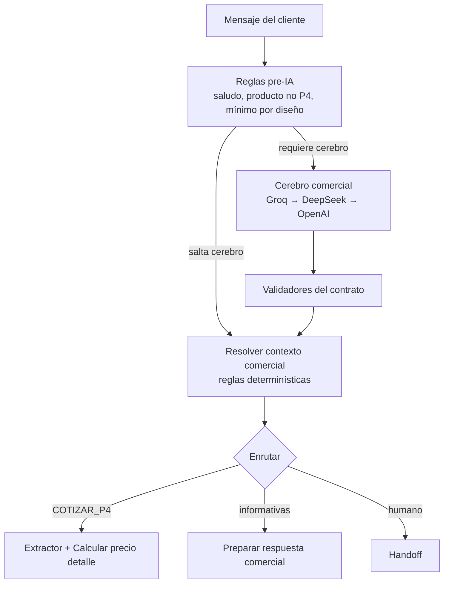

# Análisis: razonamiento a nivel vendedor y aprendizaje de las IAs

**Fecha:** 15 de octubre de 2026 · **Workflow:** SISTEMA AUTOMATIZADO PEGASO  
**Alcance:** solo análisis y documentación. No cambia código ni se publica nada.

---

## Veredicto en una frase

El sistema **ya está bien / muy bien** como vendedor automático de etiquetas adhesivas P4: conoce las reglas del negocio, cotiza con fórmula fija, evita errores comunes y deriva cuando corresponde. Lo que **no** es (ni debe pretender ser sin más diseño) es un vendedor humano que improvisa, negocia con criterio comercial fino o “recuerda” clientes entre semanas. Las IAs **no aprenden** de cada conversación: cada turno es una respuesta nueva construida con el prompt fijo + el contexto que le pasamos nosotros.

---

## 1. Cómo “piensa” el sistema hoy

No es una sola IA hablando. Hay **tres capas** que se complementan:



| Capa | Quién decide | Ejemplos |
|---|---|---|
| **Pre-IA** | Código, sin llamar al modelo | Saludo simple; producto que no es etiqueta; reparto imposible entre diseños |
| **Cerebro (IA)** | Interpreta intención y redacta | “¿De qué material?”, “quiero de 5x5”, “cómo se pagan” |
| **Post-IA / determinístico** | Código corrige o bloquea a la IA | Mínimo 1000; no recotizar sin cambio; medidas grandes > $140; cantidad ≥ 6000 → humano; precio solo en `Calcular precio detalle` |

Eso es la arquitectura correcta para un negocio con **precios y reglas fijas**: la IA entiende y habla; el código garantiza que no invente precios ni rompa políticas.

---

## 2. Qué ya tiene de “vendedor de etiquetas”

Cubierto de forma sólida (prompt del cerebro ~40 secciones + reglas en código):

| Capacidad de vendedor | Estado |
|---|---|
| Identidad Pegaso (productor, no crea logos) | Sí |
| Cotizar P4 con medidas + cantidad (default 1000) | Sí |
| Material, ubicación, entregas, metodología, pago | Sí + imágenes informativas |
| Mínimo de impresión y no repartir entre diseños | Sí (pre-IA + prompt) |
| No recotizar sin cambio real / ml ≠ cantidad | Sí |
| Confirmar medidas cuando el precio / 1000 > $140 | Sí |
| Tras publicidad: no callar; acotar ancho/alto | Sí |
| Diseño: no crear marca; metodología de propuesta | Sí |
| Comprobante / pago → humano | Sí |
| Negociación / reclamo / llamada → humano | Sí (prompt) |
| Cascada de proveedores si uno falla | Sí |
| Memoria comercial en `contexto_comercial` + historial 24 h | Sí |

Para el **80–90 %** de los chats de cotización y consultas frecuentes, el sistema ya opera como un vendedor entrenado con el manual de Pegaso.

---

## 3. Qué falta para razonar “como un buen vendedor”

No son bugs del flujo; son **capacidades de venta** que aún no están modeladas o están a medias.

### 3.1 Alta prioridad comercial

| Falta | Por qué importa |
|---|---|
| **Ruta de clientes registrados** | Hoy `¿Cliente existente?` [T] no está conectado: un cliente de la base puede quedar sin respuesta. Un vendedor sí los atiende distinto. |
| **Cierre de pedido / validar abono** | `ENVIAR_DATOS_PAGO` ya envía la imagen de cuentas (sin handoff). Siguen sin destino: `VALIDAR_ABONO` y `REGISTRAR_ACEPTACION`. El handoff de pago es al recibir comprobante. |
| **Respuesta cuando fallan las tres IAs** | Hoy el flujo termina sin avisar al cliente ni a Pegaso. |
| **Pedidos multi-medida con un tramo ≥ 6000** | Puede quedar sin respuesta al cliente (error en mínimo de impresión). |
| **Huellas completas de las preguntas rápidas del anuncio** | Solo material (y medidas/saludo) están bien registradas; el resto depende de redes de seguridad. |

### 3.2 Nivel “vendedor experto” (nice to have)

| Capacidad | Hoy | Ideal |
|---|---|---|
| Reconocer al prospecto que vuelve a los 3 días | Sesión nueva a las 24 h; cotización vieja no se reusa a ciegas | Saludo de continuidad + “¿seguimos con las de 7x11.5?” |
| Empujar al siguiente paso (diseño → abono → producción) | Tras cotizar pide diseño / cierra con frases variables | Secuencia comercial explícita por etapa del embudo |
| Comparar alternativas (5x5 vs 6x6) con criterio | Cotiza o pide confirmación si es cara | Explicar por qué sube el precio y sugerir medida viable |
| Detectar “solo estoy cotizando” vs “quiero comprar ya” | Clasificación A/B/C en prompt | Priorizar handoff o datos de pago solo en A/B calientes |
| Audio / imagen fallidos | Ramas de error incompletas | Mensaje al cliente: “no pudimos leer el audio/archivo” |
| Aprendizaje de objeciones reales | No existe | Biblioteca de respuestas a partir de chats derivados a humano |

### 3.3 Lo que **no** conviene pedirle a la IA

- Inventar o “mejorar” precios (la fórmula debe seguir solo en `Calcular precio detalle`).
- Prometer fechas exactas (ya se fuerza la metodología semanal).
- Crear logos o marcas (regla de negocio Clara).
- Sustituir al humano en negociación de volumen ≥ 6000 o reclamos.

---

## 4. ¿Hay procesos que se repiten o sobran?

### Redundancia útil (mantener)

| Qué se repite | Por qué está bien |
|---|---|
| Tres cerebros / tres extractores / tres validadores | Cascada de respaldo si un proveedor falla |
| Prompt con reglas + código que las refuerza | La IA orienta; el código evita que se equivoque (recotización, mínimo, medidas grandes) |
| Debounce + omisión de eco automático | Dos defensas contra duplicar el mensaje de la publicidad |

### Redundancia costosa (mejorar cuando se pueda)

| Qué sobra o complica | Efecto |
|---|---|
| Validadores ×3 casi idénticos | Un cambio de regla hay que copiarlo tres veces |
| `Aplicar reglas comerciales determinísticas` no enruta | Parte de su lógica es “decorativa” para la ruta; la decisión real la toma `Resolver contexto comercial` |
| Acciones del switch sin cablear | Decisión fantasma: se guarda contexto pero no hay respuesta |
| Nodos aislados / nombres confusos | Mantenimiento más difícil, no afecta al cliente si no se tocan |

### ¿El diseño actual está bien?

**Sí, como arquitectura de bot comercial con reglas duras.**  
No está “sobre-ingenierizado” de más: la mezcla IA + determinístico es la forma correcta de no regalar precios ni políticas. Lo que falta es **cerrar huecos de ruta** (clientes, pago, fallo de IA) y **afinación de vendedor** (continuidad, cierre), no reescribir el cerebro desde cero.

---

## 5. ¿Las IAs aprenden de lo que les enviamos?

### Respuesta corta

**No.** Cada ejecución es independiente. El modelo **no se entrena** con los chats de Pegaso. No “guarda” lo que le dijimos ayer en su cerebro. Lo que parece memoria es **contexto que nosotros le armamos en ese turno**.

### Cómo funciona cada respuesta

```text
Turno N del cliente
    │
    ├─ Historial reciente (hasta 24 h / máx. 24 mensajes)
    ├─ contexto_comercial (cotización, confirmaciones, imágenes enviadas…)
    ├─ Prompt fijo del cerebro (~40 secciones de reglas Pegaso)
    └─ Mensaje actual
         │
         ▼
    Llamada nueva a Groq / DeepSeek / OpenAI
         │
         ▼
    JSON (intención, acción, respuesta_sugerida, …)
         │
         ▼
    Código corrige / bloquea / cotiza / envía
```

| Pregunta | Respuesta |
|---|---|
| ¿Aprende entre un mensaje y el siguiente? | No. Solo ve el historial y el contexto que le inyectamos en **esta** llamada. |
| ¿La misma pregunta da siempre la misma respuesta? | No necesariamente. Temperatura baja ayuda, pero el texto puede variar; por eso hay reglas determinísticas y validadores. |
| ¿Si corrijo el prompt, “aprende” para siempre? | El **prompt** cambia para todas las llamadas futuras. Eso no es aprendizaje del modelo; es instrucción nueva. |
| ¿Fine-tuning / entrenamiento con chats de Pegaso? | **No está configurado.** Los modelos (Groq `openai/gpt-oss-20b`, DeepSeek `deepseek-flash`, OpenAI `gpt-5-mini`) se usan como API genérica. |
| ¿Dónde “recuerda” el bot entonces? | En **PostgreSQL**: mensajes, `contexto_comercial` de la conversación, banderas del prospecto. Eso sí es memoria de negocio. |

### Analogía

Es como un vendedor nuevo que **cada mañana lee el manual** (prompt) y **la carpeta del cliente de hoy** (historial + contexto), atiende, y se va. No acumula experiencia personal; mañana otro “clon” lee el mismo manual. Si el manual o la carpeta mejoran, el servicio mejora — no porque el modelo haya aprendido solo.

---

## 6. Prioridades recomendadas (si se quiere subir de nivel)

1. **Cerrar rutas rotas:** clientes registrados; `VALIDAR_ABONO` / `REGISTRAR_ACEPTACION`; mensaje cuando fallen las tres IAs. (`ENVIAR_DATOS_PAGO` + comprobante → humano: hecho; ver reporte 2026-10-15-datos-pago-comprobante.)
2. **Completar huellas de anuncios** con todas las respuestas rápidas de Facebook.
3. **Embudo post-cotización:** un solo camino claro diseño → abono → evidencia (hoy está en el prompt; falta cableado fiable).
4. **Continuidad de sesión** (> 24 h): saludo que recupere la última cotización sin recotizar a ciegas.
5. **Solo después:** unificar validadores duplicados y limpiar nodos muertos (mantenimiento, no venta).

---

## 7. Conclusión

| Pregunta | Respuesta |
|---|---|
| ¿Está bien / muy bien? | **Muy bien** para cotizar y responder lo frecuente con reglas de Pegaso. |
| ¿Falta razonamiento de vendedor? | Falta sobre todo **cierre de pedido, atención a clientes y continuidad**; no falta “más IA” a ciegas. |
| ¿Hay redundancia? | Sí, útil (cascada + doble control) y algo costosa (validadores ×3, switch incompleto). |
| ¿Las IAs aprenden? | **No.** Cada turno es una respuesta nueva; la memoria real está en la base y en el prompt. |

Documentos relacionados: [FLUJO-WORKFLOW-PEGASO.md](FLUJO-WORKFLOW-PEGASO.md) (§11 cerebro, §18 observaciones), [ARQUITECTURA-PEGASO-N8N.md](ARQUITECTURA-PEGASO-N8N.md), reportes en [reportes/](reportes/).
