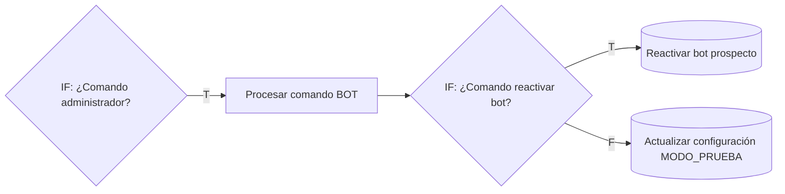

# Comando ACTIVEBOT: reactivar el bot para un prospecto derivado a humano

**Resultado:** un administrador puede escribir `ACTIVEBOT 0999999999` al número del bot, igual que hoy con `STOP` y `START`, y el bot vuelve a atender a ese prospecto. Pone `requiere_humano = FALSE` y el bot responde desde el siguiente mensaje del cliente, sin esperar los 10 minutos de la guardia humana.

**Estado:** implementado en local. No se publicó en n8n, no hay commit ni push.

---

## 1. Problema

Cuando un prospecto se deriva a humano (`ultima_accion = DERIVAR_HUMANO`), el bot deja de atenderlo por dos mecanismos independientes:

| Mecanismo | Dónde | Qué lo apaga antes de este cambio |
|---|---|---|
| Bandera `prospectos.requiere_humano = TRUE` | `¿Requiere atención humana?`, antes del Wait | Nada desde WhatsApp. Solo `Crear prospecto` la pone en `FALSE` |
| Guardia humana de 10 minutos | `Resolver turno conversacional`, después del Wait | El paso del tiempo: 10 minutos sin mensajes humanos de Pegaso |

Apagar solo la bandera no basta: si el asesor escribió hace menos de 10 minutos, la guardia sigue bloqueando el turno. Ese caso es justamente el de "el asesor terminó y quiere devolverle el cliente al bot".

## 2. Uso

Desde un teléfono administrador (la misma lista de `STOP`/`START`), enviar al número del bot:

```text
ACTIVEBOT 0999999999
```

| Formato aceptado | Se guarda como |
|---|---|
| `ACTIVEBOT 0999999999` | `593999999999` |
| `activebot 999999999` | `593999999999` |
| `ACTIVEBOT 593999999999` | `593999999999` |
| `ACTIVEBOT +593 99 999 9999` o `099-999-9999` | `593999999999` |

No se acepta texto adicional ("ACTIVEBOT 0999999999 gracias") ni el comando sin número: en esos casos el mensaje no se trata como comando y sigue el flujo normal.

El administrador no recibe confirmación por WhatsApp, igual que con `STOP`/`START`. El resultado se ve en la ejecución de n8n (nodo `Reactivar bot prospecto`).

## 3. Cambios

### Estructura del workflow



- **Antes:** `Procesar comando BOT` → `Actualizar configuración MODO_PRUEBA`.
- **Ahora:** se agregan dos nodos (`IF: ¿Comando reactivar bot?` y `Reactivar bot prospecto`). `STOP`/`START` siguen llegando al mismo `UPDATE` por la rama *false*.
- **Totales:** de 184 a **186 nodos** y de 221 a **223 conexiones** (211 `main`). No se renombró ningún nodo ni cambió ningún Node ID existente. `Actualizar configuración MODO_PRUEBA` solo se movió en el lienzo.

### Por nodo

| Nodo | Archivo | Versión | Cambio |
|---|---|---|---|
| `IF: ¿Comando administrador?` | `edit.json` | — | Además de `STOP`/`START`, acepta `ACTIVEBOT` seguido de un número (`/^ACTIVEBOT\s+[+\d][\d\s\-().]*$/` sobre el texto en mayúsculas) |
| `Procesar comando BOT` | `procesar-comando-bot.js` | 1.0 → **2.0** | Reconoce `ACTIVEBOT <teléfono>`, normaliza el número a dígitos con prefijo 593 y emite `telefono_objetivo` y `motivo_cambio = COMANDO_ADMIN_ACTIVEBOT`. Con un teléfono inválido lanza error. `STOP`/`START` sin cambios (`telefono_objetivo = null`) |
| `IF: ¿Comando reactivar bot?` (nuevo) | `edit.json` | — | `comando_bot === 'ACTIVEBOT'` |
| `Reactivar bot prospecto` (nuevo) | `edit.json` | — | Postgres, misma credencial que `Actualizar configuración MODO_PRUEBA`. Ver abajo |
| `Resolver turno conversacional` | `resolver-turno-conversacional.js` | 1.2 → **1.3** | La guardia humana ignora los SALIENTE humanos con id menor al último marcador `[BOT REACTIVADO POR ADMINISTRADOR` |
| `Preparar contexto IA` | `preparar-contexto-ia.js` | 4.3 → **4.4** | El marcador se excluye del historial y de `ultimo_saliente`, igual que los marcadores de respuesta omitida (helper `esMarcadorInterno`) |

### SQL de `Reactivar bot prospecto`

Una sola sentencia con tres pasos:

1. `UPDATE pegaso.prospectos SET requiere_humano = FALSE` para el o los prospectos WHATSAPP cuyo teléfono, normalizado a `593…`, es `telefono_objetivo` (ver la corrección en §5).
2. Elige su conversación WHATSAPP: primero la `ACTIVA` (la que lee la ruta del cliente) y, si no hay, la más reciente.
3. Inserta en esa conversación un mensaje SALIENTE `[BOT REACTIVADO POR ADMINISTRADOR]` sin `mensaje_externo_id`, `procesado = TRUE`.

Devuelve `telefono_objetivo`, `prospectos_reactivados` (0 si el teléfono no existe; en ese caso no cambia nada), `prospecto_id`, `conversacion_id` y `marcador_id`.

- **`ultima_accion`:** no se toca. Es informativa (ningún IF ni prompt la usa para bloquear) y el siguiente turno del bot la sobrescribe.
- **Interpolación:** la única es `{{ $json.telefono_objetivo }}`, que `Procesar comando BOT` ya validó como 11 a 15 dígitos, así que no hay riesgo de inyección.

### Por qué un marcador en `mensajes`

La guardia humana se basa en el historial de la conversación, no en la bandera. El marcador deja constancia en ese mismo historial de que un administrador devolvió el cliente al bot:

- Los mensajes humanos **anteriores** al marcador dejan de contar para la guardia.
- Un mensaje humano **posterior** (el asesor vuelve a escribir) levanta la bandera y activa la guardia como siempre.
- Al no tener `mensaje_externo_id`, el marcador cuenta como SALIENTE del bot y corta el turno: lo que el cliente escribió antes del comando no se vuelve a responder.
- `Preparar contexto IA` lo excluye, así que nunca llega al cerebro ni se cuenta como respuesta enviada.

## 4. Verificación

Se ejecutó el código real de los nodos y la expresión real del IF leída de `edit.json` (harness en `%TEMP%`, fuera del repo). Resultado: **41/41 OK**.

| Grupo | Casos |
|---|---|
| `Procesar comando BOT` | Cinco formatos de número normalizan a `593…`; `ACTIVEBOT 12` y `ACTIVEBOT` solo dan error controlado; un teléfono no administrador da error; `STOP`/`START` producen exactamente la salida anterior |
| `IF: ¿Comando administrador?` | `true` para ACTIVEBOT con número desde ambos administradores, `STOP`, `START`. `false` para no administrador, sin número, con texto extra y "hola". Todo lo que el IF deja pasar lo procesa `Procesar comando BOT` sin error |
| Estructura | Nodos y conexiones; el SQL pone `FALSE`, no toca `ultima_accion`, inserta el marcador sin `mensaje_externo_id` y solo interpola `telefono_objetivo`; la copia `activeVersion` sigue con 184 nodos y sin ACTIVEBOT |
| Guardia humana | Sin marcador, un humano de hace 200 s bloquea el turno (control). Con marcador posterior, el turno continúa. Un humano posterior al marcador vuelve a bloquear |
| Contexto IA | El marcador no aparece en la salida de `Preparar contexto IA`; `ultimo_saliente` sigue siendo el humano; el cliente recibe respuesta |

Regresión sin cambios: conversacional, auditoría, mínimo por diseño, cierre de cotizaciones y precios **OK**. `inject-code.mjs`, `validate-workflow.mjs` (186 nodos) y `check-encoding.mjs` **OK**.

## 5. Corrección tras la primera prueba en n8n

**Síntoma:** el comando llegó y `Procesar comando BOT` resolvió bien el número, pero `Reactivar bot prospecto` devolvió `prospectos_reactivados = 0` y el prospecto siguió con `requiere_humano = TRUE`.

**Diagnóstico:** se ejecutó la sentencia original en un Postgres en memoria (PGlite) con las tablas de `schema/pegaso_schema.sql`. Las columnas coinciden con el esquema y la sentencia funciona, pero el `WHERE` era demasiado estricto. Devolvía 0 si el teléfono estaba guardado en formato local (`09…` o 9 dígitos) o si el prospecto tenía `activo = FALSE`. El esquema no impone formato a `prospectos.telefono` (`varchar(30)` con unicidad sobre el texto exacto).

**Cambio en `Reactivar bot prospecto`:**

| Antes | Ahora |
|---|---|
| `regexp_replace(telefono, '\D', '', 'g') = telefono_objetivo` | El teléfono guardado se normaliza igual que el del comando: solo dígitos con `[^0-9]` (sin backslash), y `09…` o 9 dígitos pasan a `593…` |
| `AND activo = TRUE` | Sin filtro de `activo`: el administrador nombra el número explícitamente. La salida informa `prospecto_activo` |
| `canal = 'WHATSAPP'` | `UPPER(TRIM(canal)) = 'WHATSAPP'` |
| `ORDER BY (estado = 'ACTIVA') DESC` | `COALESCE(estado = 'ACTIVA', FALSE) DESC`: con `estado` NULL, `NULL DESC` quedaba primero |
| Salida sin datos del prospecto | Agrega `telefono_guardado` y `prospecto_activo` para diagnosticar desde la ejecución |

**Verificación en PGlite (10/10 OK):** reactiva con el teléfono guardado como `593…`, `+593…`, `+593 9x xxx xxxx`, `09…`, 9 dígitos, con `standard_conforming_strings` desactivado, con `activo = FALSE` y con canal en minúsculas. En todos elige la conversación ACTIVA aunque haya otras más recientes cerradas o con estado NULL, e inserta un único marcador SALIENTE sin `mensaje_externo_id`. No toca otro número ni otro canal.

Si después de esta corrección sigue devolviendo 0, el número no existe como prospecto WHATSAPP; por ejemplo, porque es un cliente registrado en `contactos`, una ruta que hoy el bot no atiende.

## 6. Riesgos y límites

- **Sin confirmación al administrador.** Si el número no corresponde a ningún prospecto, no pasa nada y el administrador no se entera. Se puede agregar una respuesta por YCloud con `prospectos_reactivados` si se quiere.
- **Mensajes del cliente durante la derivación.** El bot no responde a lo que el cliente escribió antes del comando; responde desde su siguiente mensaje.
- **Lista de administradores duplicada.** Está en `IF: ¿Comando administrador?` y en `Procesar comando BOT` (observación 11 de [FLUJO §18](../FLUJO-WORKFLOW-PEGASO.md#18-observaciones-y-posibles-problemas)). Si se agrega un administrador, hay que cambiar ambos.
- **Prueba en n8n pendiente.** Tras publicar: derivar un prospecto de prueba, que un asesor escriba desde WhatsApp Business, enviar `ACTIVEBOT` con su número y comprobar que el bot responde al siguiente mensaje del cliente.

Documentación actualizada: [FLUJO-WORKFLOW-PEGASO.md §5](../FLUJO-WORKFLOW-PEGASO.md#5-comandos-de-administrador-modo_prueba-y-activebot), fichas de `IF: ¿Comando administrador?`, `Resolver turno conversacional` y `Preparar contexto IA`, puntos finales de ejecución y observación 19 de §18.
