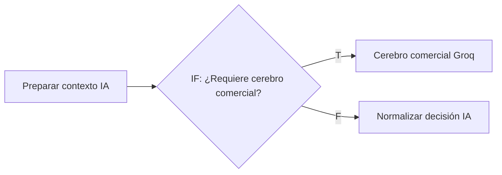

# Control conversacional determinístico: saludos, humanos, ecos, fechas y productos no P4

**Fecha:** 13 de octubre de 2026 · **Workflow:** SISTEMA AUTOMATIZADO PEGASO (`09OF22FOxihypeeh`)
**Estado:** implementado y verificado en local. **No** se publicó en n8n (`push.ps1` no se ejecutó), no hay commit ni `git push`.

El bot dejó de responder a los mensajes que Pegaso envía desde WhatsApp Business y de repetir preguntas que la automatización del anuncio ya hizo. Además, respeta la atención humana durante toda la conversación, saluda sin gastar IA, deriva sin IA los impresos que no son etiquetas y nunca promete una fecha de entrega. Todo se resolvió con lógica determinística en nodos Code existentes y un solo nodo IF nuevo. **No se modificó ningún prompt.**

---

## Índice

1. [Resumen para revisar rápido](#1-resumen-para-revisar-rápido)
2. [Qué se pidió](#2-qué-se-pidió)
3. [Diagnóstico: por qué pasaba](#3-diagnóstico-por-qué-pasaba)
4. [Qué se cambió, por problema](#4-qué-se-cambió-por-problema)
5. [Cómo se hizo, nodo por nodo](#5-cómo-se-hizo-nodo-por-nodo)
6. [Cambios estructurales en el workflow](#6-cambios-estructurales-en-el-workflow)
7. [Contrato: campos nuevos](#7-contrato-campos-nuevos)
8. [Impacto en tokens y latencia](#8-impacto-en-tokens-y-latencia)
9. [Qué NO se cambió y por qué](#9-qué-no-se-cambió-y-por-qué)
10. [Verificación](#10-verificación)
11. [Riesgos residuales](#11-riesgos-residuales)
12. [Decisiones pendientes](#12-decisiones-pendientes)
13. [Cómo publicar y cómo revertir](#13-cómo-publicar-y-cómo-revertir)

---

## 1. Resumen para revisar rápido

| Problema | Antes | Ahora | Dónde |
|---|---|---|---|
| P1 Saludo simple | "Hola" iba al cerebro (≈ 9–10k tokens) y a veces se derivaba a humano | Respuesta fija "Buenas tardes 🤗 ¿En qué podemos ayudarle?", sin IA | `Preparar contexto IA` + IF nuevo |
| P2 Mensajes humanos | Los ecos automáticos se trataban como humanos y la bandera humana se apagaba en cada turno de la IA | Clasificación humano / automático / bot; la bandera solo se levanta y la guardia se revisa después de la espera | Entrada, ruta de salida, `Resolver turno conversacional`, `Preparar actualización prospecto` |
| P3 Fechas | La IA podía prometer "para el 15" | Responde con la metodología semanal y guarda la fecha pedida | `Resolver contexto comercial` |
| P4 Productos no P4 | "¿Hacen tarjetas?" podía terminar en PEDIR_MEDIDAS | Va a humano (`COTIZACION_ESPECIAL`) sin IA | `Preparar contexto IA` + `Resolver contexto comercial` |
| P5 Doble respuesta en anuncios | El bot repetía la pregunta de medidas que ya hizo la automatización del anuncio | Pide solo lo que falta u omite el envío | `Resolver contexto comercial`, `Preparar respuesta comercial`, `Preparar envío WhatsApp` |

**Archivos tocados:** 10 nodos Code en `code/_extraidos/`, `workflows/sistema-automatizado-pegaso.edit.json` (solo la copia editable) y `docs/FLUJO-WORKFLOW-PEGASO.md`.

**Qué revisar primero:**
1. La ruta de salida, en [§5.1](#51-clasificación-de-ecos-normalizar-evento-whatsapp) y [§5.2](#52-ruta-de-salida-y-bandera-humana): es lo que evita bucles con los ecos.
2. Las reglas previas a la IA en [§5.4](#54-reglas-pre-ia-preparar-contexto-ia--if-nuevo): deciden cuándo no se llama al cerebro.
3. Los riesgos residuales en [§11](#11-riesgos-residuales).

---

## 2. Qué se pidió

Mejorar el comportamiento conversacional **con lógica determinística, banderas, estado persistido, anti-duplicados, debounce y control de salientes y humanos**. Los prompts solo como último recurso.

Orden de preferencia indicado:
1. Reutilizar nodos Code existentes.
2. Reforzar las reglas determinísticas existentes.
3. Reutilizar campos y estados existentes.
4. Crear un nodo nuevo solo si evita duplicación, bucles o un crecimiento fuerte de los prompts.
5. Modificar prompts únicamente como último recurso.

Restricciones respetadas:
- No borrar reglas comerciales ni reescribir el cerebro.
- No renombrar nodos ni cambiar Node IDs.
- No cambiar tablas ni agregar migraciones SQL.
- No romper imágenes, audio, cotización, mínimo de impresión, derivación ≥ 6000, comprobantes, intervención humana, debounce ni modo prueba.
- No ejecutar `pull.ps1`, `push.ps1` ni `extract-code.mjs`; no hacer commit ni `git push`.

---

## 3. Diagnóstico: por qué pasaba

El diagnóstico se hizo leyendo el código real de los nodos y revisando ejecuciones reales de producción. Los datos de ejecución se descargaron a una carpeta temporal fuera del repo; aquí solo se resumen los hallazgos.

### 3.1 Metadatos reales de YCloud

| Evento | Qué es | Detalle relevante |
|---|---|---|
| `whatsapp.inbound_message.received` | Mensaje del cliente | Los leads de anuncio traen `whatsappInboundMessage.referral` (`source_type = ad`, `ctwa_clid`, `headline`) |
| `whatsapp.smb.message.echoes` | Mensaje que salió desde la app WhatsApp Business (`from` = Pegaso, `to` = cliente) | **No** trae ningún campo que distinga a una persona de una respuesta automática de la app |
| `whatsapp.message.updated` | Cambio de estado (entregado, leído) | No es procesable |
| Envíos del bot por API | — | No generan eco |

Otros hechos útiles:
- `mensajes.mensaje_externo_id` tiene un índice único parcial: un wamid de eco nunca puede reinsertarse como ENTRANTE.
- Los SALIENTE que guarda el bot (`Guardar mensaje saliente`, `Guardar mensaje comercial`, `Guardar mensaje transición humano`) **no** guardan `mensaje_externo_id`; los ecos (`Guardar mensaje humano saliente`) **siempre** lo guardan.

### 3.2 Causas raíz

| # | Causa | Efecto observado |
|---|---|---|
| C1 | `Normalizar evento WhatsApp` marcaba **todo** eco como humano, incluidas las respuestas automáticas de WhatsApp Business (bienvenida y respuesta del anuncio) | Un lead de anuncio quedaba marcado `requiere_humano` por la respuesta automática y el bot dejaba de atenderlo, o se mezclaban los mensajes |
| C2 | `Preparar actualización prospecto` → `Actualizar prospecto comercial` escribía `requiere_humano` con el valor de la decisión de la IA (normalmente `false`) | La bandera que levantaba un humano se apagaba en el siguiente turno de la IA: el bot volvía a contestar encima del humano |
| C3 | La entrada de `Preparar actualización prospecto` es solo la fila que devuelve el UPDATE de `Guardar contexto comercial`, sin la decisión | `ultima_accion` y `ultima_intencion` se escribían en `null` y `producto_interes` se perdía en cada turno |
| C4 | La bandera humana solo se leía **antes** del Wait (`¿Requiere atención humana?` sobre `Unificar prospecto`) | Si el humano escribía durante la espera, el bot respondía igual |
| C5 | El eco automático del anuncio llega 2–8 s después del primer mensaje; el debounce era de 3 s | El bot respondía al primer mensaje antes de saber que la automatización ya había preguntado las medidas: doble pregunta |
| C6 | El anti-duplicado de `Preparar respuesta comercial` leía `data.ultimo_mensaje_saliente`, que no llega a ese nodo | El anti-duplicado nunca actuaba |
| C7 | No había regla de saludo simple | "Buenas tardes." pasaba por el cerebro; hubo un caso real derivado a humano |
| C8 | No había regla de fechas ni de productos no P4 en el prompt ni en el código | Riesgo de prometer fechas y de pedir medidas para tarjetas o flyers |

**Por qué se escapaban casos de "¿Requiere atención humana?":** la condición solo ve la bandera persistida antes del Wait. La bandera podía estar mal puesta (C1), apagada por la IA (C2) o levantarse durante la espera (C4). Las tres vías se cerraron.

---

## 4. Qué se cambió, por problema

### P1 · Saludo simple
- **Qué:** si el turno es solo texto y todas sus palabras pertenecen al vocabulario de saludo, con al menos un saludo núcleo ("hola", "buenas", "buenos", "saludos"…), se responde con un texto fijo sin llamar a la IA.
- **Por qué determinístico:** un saludo no necesita interpretación; el cerebro cuesta unos 9–10k tokens por llamada y a veces sobre-reaccionaba.
- **Límite deliberado:** "Hola, necesito etiquetas de 5x5" **no** es saludo simple (tiene palabras fuera del vocabulario) y va al cerebro.

### P2 · Humanos, ecos y bucles
- **Qué:**
  - Todo eco va a la ruta de salida y nunca a la del cliente.
  - El eco automático se registra con prefijo y no marca humano.
  - La bandera humana solo la levantan las rutas de derivación e intervención humana.
  - Después de la espera se vuelve a comprobar si escribió un humano.
- **Por qué:** cierra las tres causas de [§3.2](#32-causas-raíz) (C1, C2 y C4) y evita bucles por dirección e ID externo.
- **Política por conversación:** se reutilizan `prospectos.requiere_humano` y el historial de `mensajes`; no se agregaron columnas.

### P3 · Fechas y metodología
- **Qué:** si el cliente pide una fecha ("para el 15", "para el viernes", "15 de octubre", "lo necesito para…") o la respuesta de la IA promete una, se responde con la metodología semanal. La fecha pedida se guarda en `contexto_comercial.fecha_deseada_cliente`.
- **Texto:** "Trabajamos con una metodología semanal: recibimos pedidos de lunes a miércoles, producimos miércoles y jueves, y realizamos entregas y envíos los viernes a partir de las 17:00. El viernes de entrega se confirma según el día en que ingrese su pedido."
- **Por qué en código:** una promesa de fecha es un compromiso comercial; no puede depender de que la IA lo recuerde.

### P4 · Productos que no son etiquetas P4
- **Qué:** tarjetas de presentación, flyers/volantes, carpetas, talonarios, boletos, entradas, formularios, hojas membretadas, trípticos/dípticos, afiches y brochures van a `DERIVAR_HUMANO` con motivo `COTIZACION_ESPECIAL`, sin IA.
- **Límite deliberado:** si el texto menciona etiquetas, stickers, adhesivos, calcomanías, pegatinas, rótulos o vinil, la regla **no** aplica y decide el cerebro (por ejemplo, "stickers para tarjetas de presentación").
- **Por qué:** nunca pedir medidas ni cotizar P4 para algo que no es etiqueta, y nunca decir "no hacemos eso".

### P5 · Doble respuesta en anuncios
- **Qué:** el anti-duplicado se orienta a **acciones**, no solo a textos idénticos:
  - Si las medidas ya se pidieron (por el bot, la automatización o un humano) y el turno trae datos nuevos, se responde solo lo que falta.
  - Si no trae datos nuevos, no se envía nada.
  - Si un eco automático posterior al inicio del turno ya cubrió la misma acción, no se envía nada.
- **Por qué:** el problema real no eran textos iguales, sino la misma pregunta con otras palabras.
- **No bloquea al lead:** los ecos automáticos no marcan humano, así que el siguiente mensaje del cliente se procesa normalmente.

---

## 5. Cómo se hizo, nodo por nodo

Todos los archivos están en `code/_extraidos/`. En cada uno se actualizó el encabezado (`VERSION`, `RESPONSABILIDAD`).

### 5.1 Clasificación de ecos (`Normalizar evento WhatsApp`)

`normalizar-evento-whatsapp.js` · versión 2.0 → **2.1**

- Lista `AUTOMATIZACIONES_WHATSAPP_BUSINESS` con las plantillas actuales de la app y su acción equivalente:

  | Código | Coincidencia | Acción equivalente |
  |---|---|---|
  | `RESPUESTA_ANUNCIO_MEDIDAS` | El texto empieza con la plantilla | `PEDIR_MEDIDAS` |
  | `BIENVENIDA_PEGASO` | El texto empieza con la plantilla | `SALUDO` |
  | `BIENVENIDA_ANUNCIO` | Texto exacto | `SALUDO` |

- La comparación usa una "huella" del texto: minúsculas, sin tildes, sin signos, espacios simples. No la afectan la puntuación ni los emojis.
- Campo nuevo `clasificacion_mensaje`: `ENTRANTE_CLIENTE`, `SALIENTE_AUTOMATICO` o `SALIENTE_HUMANO`. Todo eco tiene `direccion = SALIENTE`.
- `es_mensaje_humano_pegaso` ahora es `false` para los ecos automáticos.
- Anuncios: `extraerAnuncio(referral)` expone `es_lead_anuncio` y `anuncio` (`source_type`, `source_id`, `source_url`, `headline`, `ctwa_clid`, `welcome_message`).

### 5.2 Ruta de salida y bandera humana

**`Normalizar intervención humana`** · `normalizar-intervencion-humana.js` · 1.0 → **1.1**
- Al contenido automático le antepone `[AUTOMATICO WHATSAPP BUSINESS · accion=<ACCION>]`.
- Emite `intervencion_humana` (`false` si es automático), `origen_mensaje` (`HUMANO` / `AUTOMATICO_WHATSAPP_BUSINESS`), `clasificacion_mensaje`, `automatizacion_codigo` y `accion_equivalente`.

**`Preparar mensaje humano saliente`** · `preparar-mensaje-humano-saliente.js` · **1.1**
- Propaga `origen_mensaje` e `intervencion_humana`; conserva `mensaje_externo_id` (necesario para el `ON CONFLICT … DO NOTHING`).

**Regla para saber quién envió un SALIENTE**, usada por varios nodos y sin columnas nuevas:

| `mensaje_externo_id` | Prefijo `[AUTOMATICO WHATSAPP BUSINESS` | Origen |
|---|---|---|
| vacío | — | BOT |
| presente | sí | AUTOMATICO |
| presente | no | HUMANO |

### 5.3 Debounce y turno

**`Resolver permiso automatización`** · `resolver-permiso-automatizacion.js` · 2.0 → **2.1**
- **Primer contacto** = lead de anuncio, conversación nueva o sin turno del bot en 24 h (según `contexto_comercial.sesion.actualizado_at`).
- En primer contacto la espera pasa de 3 s a **10 s**. Se configura con `debounce_primer_contacto_ms` en la fila `DEBOUNCE_WHATSAPP` de `configuracion_bot` (opcional; el máximo sigue siendo 15 s).
- Campo nuevo `debounce_motivo`: `NORMAL`, `PRIMER_CONTACTO_ANUNCIO`, `PRIMER_CONTACTO_CONVERSACION_NUEVA` o `PRIMER_CONTACTO_SESION_NUEVA`.
- **Por qué:** el eco automático llega 2–8 s después del primer mensaje; con 10 s queda registrado antes de resolver el turno.

**`Resolver turno conversacional`** · `resolver-turno-conversacional.js` · 1.1 → **1.2**
- **Guardia humana posterior a la espera:** si existe un SALIENTE humano posterior a este mensaje, o de hace menos de 10 minutos, devuelve `continuar_procesamiento = false` con `resultado_turno = ATENCION_HUMANA`. Los motivos son `HUMANO_RESPONDIO_DURANTE_ESPERA` o `INTERVENCION_HUMANA_RECIENTE`.
- **Frontera del turno:** los ecos automáticos ya no cortan el turno. Un "Hola", el eco del anuncio y luego "para jugos" forman un solo turno.
- Se mantiene "gana el último mensaje" (latest-wins) y el descarte de reenvíos por ID externo.

### 5.4 Reglas pre-IA (`Preparar contexto IA` + IF nuevo)

`preparar-contexto-ia.js` · 4.1 → **4.2**

- **Solo se aplican a texto sin multimedia** (`media_turno.cantidad_media === 0`). Imágenes, audio y comprobantes siguen exactamente igual.
- `SALUDO_SIMPLE`:
  - Hasta 6 palabras, todas del vocabulario de saludo, con al menos un saludo núcleo. Las letras repetidas se colapsan ("holaaa" → "hola").
  - El saludo copia el del cliente (noches, tardes, días); si no lo indica, se elige por la hora de Ecuador (UTC-5).
  - Respuesta: "Buenas tardes 🤗 ¿En qué podemos ayudarle?". Se usa 🤗 porque `Normalizar decisión IA` elimina 😊 por política de tono.
- `PRODUCTO_NO_P4`: expresiones regulares sobre el texto normalizado ([§4](#p4--productos-que-no-son-etiquetas-p4)), con la exclusión por mención de etiquetas.
- Cuando una regla aplica, emite `decision` con **el mismo contrato que devuelve el cerebro** y `requiere_cerebro_comercial = false`.
- **Último saliente:** recorre **todo** el historial de la conversación, no solo la ventana de 24 h, porque el eco automático suele llegar después del primer mensaje del turno. Expone `ultimo_saliente` (`id`, `origen`, `accion_equivalente`, `posterior_al_turno`, `contenido`) y `medidas_ya_solicitadas`. Esta última es verdadera si el último saliente con acción reconocible dentro de la ventana, ignorando saludos, pidió medidas.
- Los marcadores `[RESPUESTA AUTOMÁTICA OMITIDA` se excluyen del historial que ve el cerebro.

**`IF: ¿Requiere cerebro comercial?`** (nodo nuevo, ver [§6](#6-cambios-estructurales-en-el-workflow)):
- **Por qué un nodo y no lógica en el prompt:** es la única forma de no ejecutar los tres proveedores de IA. Un IF es la pieza más simple, sin código ni estado.
- `Normalizar decisión IA` ya leía `input.decision`, así que no hubo que cambiarlo. Ningún nodo posterior lee por nombre a los nodos del cerebro (verificado con búsqueda), así que saltarlos no rompe referencias.

### 5.5 Decisión comercial (`Resolver contexto comercial`)

`resolver-contexto-comercial.js` · V2.4 → **V2.5**

Orden de aplicación dentro del nodo:

1. **Derivación ≥ 6000** (sin cambios).
2. **`PRODUCTO_NO_P4`** → `accion = DERIVAR_HUMANO`, `motivo_derivacion = COTIZACION_ESPECIAL`, `regla_derivacion = PRODUCTO_NO_P4`, `producto_no_p4`. Se guarda en `contexto_comercial.producto_no_p4`. **No** toca `contexto_comercial.cotizacion.producto`, para no contaminar el contexto de etiquetas.
3. **Detección de fecha** (12.1):
   - Busca patrones de día de la semana, día del mes, "15 de octubre", "mañana", "esta semana" y "lo necesito para…".
   - "para el 10 x 10" **no** cuenta como fecha: se excluye un número seguido de x, cm, ml, unidades, etc.
4. **No repetir PEDIR_MEDIDAS** (12.2), si las medidas ya se pidieron:
   - Con datos nuevos en el turno (medida, cantidad, material, forma, producto distinto o fecha): "Gracias. Para cotizar sus etiquetas solo nos falta el ancho y alto / el ancho / el alto en centímetros."
   - Sin datos nuevos: `omitir_envio = true` con motivo `MEDIDAS_YA_SOLICITADAS`.
5. **Metodología** (12.3):
   - Aplica si se detectó una fecha, o si la respuesta de la IA promete una ("se las entregamos…", "estarán listas para…").
   - La respuesta pasa a ser el texto de metodología. Si además faltan medidas, se agrega la pregunta pendiente.
   - No aplica a `COTIZAR_P4` ni a `DERIVAR_HUMANO`, que tienen sus propios mensajes.
6. **Acción ya atendida** (12.4): si el último saliente es un eco **automático** posterior al inicio del turno y cubrió la misma acción (o el turno es un saludo y la automatización ya escribió), `omitir_envio = true` con motivo `ACCION_YA_ATENDIDA_POR_AUTOMATIZACION`.

Por qué aquí: `Recuperar decisión comercial` enruta con la salida de este nodo (observación 13 de [FLUJO §18](../FLUJO-WORKFLOW-PEGASO.md#18-observaciones-y-posibles-problemas)). Una regla puesta en `Aplicar reglas comerciales determinísticas` no cambiaría la ruta.

### 5.6 Respuesta y envío

**`Preparar respuesta comercial`** · `preparar-respuesta-comercial.js` · V2.2 → **V2.3**
- El anti-duplicado ahora compara con el último saliente real, leído de `Preparar contexto IA`.
- Si hay `omitir_envio` o la respuesta es idéntica, `respuesta_final` pasa a ser `[RESPUESTA AUTOMÁTICA OMITIDA · motivo=<MOTIVO>]`. Antes se enviaba "¿Qué parte desea que revisemos o aclaremos por favor?".
- El marcador **se guarda** como SALIENTE: cierra el turno, deja trazabilidad en la base y no llega al cerebro ni al cliente.
- Con `omitir_envio` no exige `respuesta_sugerida`; antes lanzaba un error si venía vacía.

**`Preparar envío WhatsApp`** · `preparar-envio-whatsapp.js` · 2.0 → **2.1**
- Nunca envía un texto que empiece con el marcador. `motivo_no_envio = RESPUESTA_OMITIDA_DUPLICADA`.
- La comprobación por prefijo funciona aunque el nodo se alcance por otra de sus tres rutas.

### 5.7 Corrección del prospecto (`Preparar actualización prospecto`)

`preparar-actualizacion-prospecto.js` · sin versión → **1.1** (se agregó el encabezado estándar)

- La decisión se toma de `$('Resolver contexto comercial')` y se combina con la fila de entrada. Es la misma fuente que usa `Recuperar decisión comercial` para enrutar, así que lo que se persiste coincide con lo que se ejecuta.
- `producto_interes` usa `producto_no_p4` cuando aplica (por ejemplo, "tarjetas de presentación").
- `requiere_humano` **ya no se persiste** desde aquí (ver [§6](#6-cambios-estructurales-en-el-workflow)).

---

## 6. Cambios estructurales en el workflow

Archivo: `workflows/sistema-automatizado-pegaso.edit.json`. Se editó **solo la copia editable** (`nodes` / `connections`); `activeVersion` quedó intacto (verificado).

| Nodo | Tipo | Cambio |
|---|---|---|
| `IF: ¿Mensaje humano de Pegaso?` | IF | Condición: `evento_whatsapp.direccion === 'SALIENTE' \|\| evento_whatsapp.es_mensaje_humano_pegaso === true` (antes solo la segunda) |
| `Marcar prospecto requiere humano2` | Postgres SQL | `SET` condicionado a `intervencion_humana` (abajo) |
| `Actualizar prospecto comercial` | Postgres update | Se quitó `requiere_humano` del mapeo (`columns.value`) y se marcó `removed: true` en su esquema |
| `IF: ¿Requiere cerebro comercial?` | IF **nuevo** | Condición `$json.requiere_cerebro_comercial !== false` |

SQL de `Marcar prospecto requiere humano2` (parte `SET`):

```sql
requiere_humano = COALESCE(requiere_humano, FALSE) OR {{ $('Normalizar intervención humana').first().json.intervencion_humana !== false }},
ultima_accion = CASE
    WHEN {{ $('Normalizar intervención humana').first().json.intervencion_humana !== false }} THEN 'DERIVAR_HUMANO'
    ELSE ultima_accion
END,
actualizado_at = CURRENT_TIMESTAMP
```

Efecto: un eco humano levanta la bandera, un eco automático no la toca y ninguno puede apagarla.

**Conexiones:**



Antes: `Preparar contexto IA` → `Cerebro comercial Groq`. Totales: de 183 a **184 nodos** y de 219 a **221 conexiones** (209 `main`). No se renombró ningún nodo ni se cambió ningún Node ID.

---

## 7. Contrato: campos nuevos

| Nodo | Campo | Uso |
|---|---|---|
| Normalizar evento WhatsApp | `clasificacion_mensaje`, `es_mensaje_automatico_pegaso`, `automatizacion_codigo`, `accion_equivalente`, `es_lead_anuncio`, `anuncio` | Enrutamiento de ecos y detección de anuncio |
| Normalizar intervención humana | `intervencion_humana`, `origen_mensaje`, `clasificacion_mensaje`, `automatizacion_codigo`, `accion_equivalente` | SQL de la bandera y fila SALIENTE |
| Resolver permiso automatización | `debounce_motivo` | Diagnóstico del Wait |
| Resolver turno conversacional | `resultado_turno = ATENCION_HUMANA`, `ultimo_saliente_humano_id` | Guardia humana |
| Preparar contexto IA | `ultimo_saliente`, `medidas_ya_solicitadas`, `regla_pre_ia`, `producto_no_p4`, `requiere_cerebro_comercial`, `decision` (solo si aplica una regla) | IF nuevo y resolver |
| Resolver contexto comercial | `regla_pre_ia`, `fecha_deseada_cliente`, `omitir_envio`, `motivo_omision_envio`, `regla_derivacion = PRODUCTO_NO_P4`, `producto_no_p4` | Respuesta, persistencia y handoff |
| Preparar respuesta comercial | `omitir_envio`, `motivo_omision_envio` | Envío |
| `contexto_comercial` (JSON en `conversaciones`) | `fecha_deseada_cliente {texto, detectada_at}`, `producto_no_p4 {producto, detectado_at}` | Memoria persistida, sin migración |

Todos los campos son **aditivos**: ningún campo existente cambió de nombre ni de tipo.

---

## 8. Impacto en tokens y latencia

| Concepto | Efecto |
|---|---|
| Saludo simple | −1 llamada al cerebro (≈ 9–10k tokens de entrada; hasta ≈ 30k si antes caía en los respaldos DeepSeek y OpenAI) |
| Producto no P4 inequívoco | −1 llamada al cerebro (igual que arriba) |
| Ecos (humanos y automáticos) | Nunca llegan al cerebro |
| Atención humana activa | El turno se descarta antes de la IA |
| Prompts | **+0 tokens** (no se modificaron) |
| Historial | −marcadores de omisión; +≈ 10 tokens por cada eco automático (prefijo con la acción) |
| Latencia | Primer contacto: la primera respuesta tarda unos 7 s más (10 s en vez de 3 s). El resto de la conversación sigue en 3 s |

El prompt del cerebro interpola `mensaje_actual`, `ultimo_mensaje_saliente`, `historial` y otros campos de `Preparar contexto IA`; los campos nuevos de [§7](#7-contrato-campos-nuevos) **no** se interpolan.

---

## 9. Qué NO se cambió y por qué

| Elemento | Motivo |
|---|---|
| Prompts de Groq, DeepSeek y OpenAI | Todo se resolvió antes o después de la IA; los prompts son el último recurso |
| Validadores del cerebro (×3) | No hizo falta; las reglas nuevas están centralizadas en un solo nodo y no se duplicaron por proveedor |
| `calcular-precio-detalle`, mínimo de impresión, extractor, mensaje de cotización | Fuera de alcance; la cotización no se tocó |
| `Aplicar reglas comerciales determinísticas` | Su `accion` no se usa para enrutar (observación 13 de §18); las reglas que cambian la ruta van en `Resolver contexto comercial` |
| Tablas y SQL de esquema | Se reutilizaron `prospectos.requiere_humano`, `mensajes.mensaje_externo_id`, el prefijo en `mensajes.contenido` y `conversaciones.contexto_comercial` |
| `¿Cliente existente?` [T] | Requiere una decisión de negocio ([§12](#12-decisiones-pendientes)) |
| `activeVersion`, `state/remote-base.json`, `snapshots/`, credenciales | Prohibido por `docs/REGLAS-PARA-CURSOR.md` |
| Cambios propios del usuario en `scripts/pull.ps1`, `code/_extraidos/manifest.json`, `state/remote-base.json` | No son parte de esta intervención; no se tocaron |

---

## 10. Verificación

### 10.1 Pruebas sobre el código real

El arnés ejecuta el código real de cada nodo (sin el encabezado) con `$input` y `$('Nodo')` simulados, y encadena los nodos como en el workflow. Está en la carpeta temporal del sistema (`pegaso-tests/conv-tests.mjs`), fuera del repo, porque usa eventos simulados con teléfonos ficticios. Las decisiones de la IA se simulan solo en los casos que pasan por el cerebro.

| # | Caso | Resultado esperado | Resultado |
|---|---|---|---|
| 1 | "Hola" | Saludo corto, sin IA, sin humano ni medidas | ✅ "Buenas tardes 🤗 ¿En qué podemos ayudarle?" |
| 2 | "Buenas tardes." | Saludo en espejo | ✅ "Buenas tardes 🤗 ¿En qué podemos ayudarle?" |
| 3 | "Hola, necesito etiquetas de 5x5" | Flujo comercial normal | ✅ Va al cerebro → `COTIZAR_P4`, 1000 por defecto |
| 4 | "¿Hacen tarjetas de presentación?" | `DERIVAR_HUMANO`, no `PEDIR_MEDIDAS` | ✅ Sin IA, `COTIZACION_ESPECIAL`, transición "Permítame un momento por favor, ya verificamos su requerimiento." |
| 5 | "Necesito 500 flyers" | `DERIVAR_HUMANO` | ✅ Sin IA, sin medidas |
| 6 | "Necesito etiquetas para yogurt" | Flujo normal | ✅ `PEDIR_MEDIDAS` con la pregunta completa |
| 7 | "Las necesito para el 15" | Sin promesa, metodología | ✅ Metodología; `fecha_deseada_cliente = "para el 15"`; con medidas pendientes agrega "solo nos falta el ancho y alto" |
| 8 | Humano: "Perfecto estimada" | SALIENTE registrado, humano marcado, sin respuesta | ✅ `SALIENTE_HUMANO`, ruta de salida, bandera levantada |
| 9 | Cliente: "Gracias" | Guardado, sin respuesta | ✅ Con bandera: `Finalizar mensaje atención humana`. Sin bandera aún: guardia post-Wait `ATENCION_HUMANA` |
| 10 | Eco del mensaje humano | No es cliente, sin IA, sin respuesta | ✅ Ruta de salida; el mismo wamid no se reinserta; los estados no son procesables |
| 11 | Anuncio con medidas ya pedidas + "Para envases de jugos" | No repetir | ✅ "Gracias. Para cotizar sus etiquetas solo nos falta el ancho y alto en centímetros."; con "ok": 0 envíos |
| 12 | Debounce: 4 mensajes rápidos | 1 respuesta | ✅ 3 `DEBOUNCE_SUPERSEDED` + 1 `PROCESAR` con los 4 mensajes; 1 llamada a IA |
| 13 | Varios ecos seguidos | 0 respuestas | ✅ Todos a la ruta de salida; el automático no marca humano, el humano sí |
| 14 | Anuncio con saludo automático | No bloquear, no duplicar | ✅ Debounce de 10 s; el saludo del bot se omite; el siguiente mensaje "etiquetas de 10x10" se cotiza |

Regresiones adicionales (todas ✅):
- Cantidad ≥ 6000 sigue derivando con `CANTIDAD_MAYORISTA`.
- "Necesito stickers para tarjetas de presentación" lo decide el cerebro.
- Un humano de hace 28 minutos con la bandera reactivada a mano permite que el bot responda.
- Una respuesta de la IA que promete fecha ("Estarán listas para el viernes") se reemplaza por la metodología.
- "para el 10 x 10" no se toma como fecha.

### 10.2 Regresión de precios

El arnés de precios existente (cálculo, factores por rango, piso de $18, tamaño grande > $130, ≥ 6000, mínimo de impresión, mensaje de cotización, handoff) pasa completo: **"TODOS LOS CASOS OK"**.

### 10.3 Validadores del repo

| Script | Resultado |
|---|---|
| `node scripts/inject-code.mjs` | OK, 69 Code Nodes inyectados en `build/` |
| `node scripts/validate-workflow.mjs` | OK, 184 nodos, 170 orígenes con conexiones |
| `node scripts/prepare-update.mjs` | OK, payload en `build/` |
| `node scripts/check-encoding.mjs` | OK, sin mojibake |

Comprobaciones adicionales:
- Los 10 nodos modificados aparecen inyectados en el build con el código idéntico al archivo.
- No hay caracteres de dibujo de cajas (U+2500–U+257F), CRLF, correos ni tokens en los archivos tocados ni en este reporte.

`npm test` no existe en este repo (no hay `package.json`). La regla del workspace lo menciona por una estructura anterior, ya documentada como obsoleta en el `README.md`.

### 10.4 `git diff --stat` de esta intervención

```
 code/_extraidos/normalizar-evento-whatsapp.js      | 192 ++++++++++-
 code/_extraidos/normalizar-intervencion-humana.js  |  54 ++-
 .../_extraidos/preparar-actualizacion-prospecto.js |  36 +-
 code/_extraidos/preparar-contexto-ia.js            | 373 ++++++++++++++++++++-
 code/_extraidos/preparar-envio-whatsapp.js         |  27 +-
 .../_extraidos/preparar-mensaje-humano-saliente.js |  10 +-
 code/_extraidos/preparar-respuesta-comercial.js    |  54 ++-
 code/_extraidos/resolver-contexto-comercial.js     | 279 ++++++++++++++-
 code/_extraidos/resolver-permiso-automatizacion.js |  56 +++-
 code/_extraidos/resolver-turno-conversacional.js   |  72 +++-
 docs/FLUJO-WORKFLOW-PEGASO.md                      |  52 +--
 workflows/sistema-automatizado-pegaso.edit.json    |  60 +++-
 12 files changed, 1205 insertions(+), 60 deletions(-)
```

A esto se suman este reporte, el índice `docs/reportes/README.md` y el enlace en el `README.md`.

---

## 11. Riesgos residuales

También registrados como observaciones 15–19 en [FLUJO §18](../FLUJO-WORKFLOW-PEGASO.md#18-observaciones-y-posibles-problemas). La [auditoría final antes de publicar](2026-10-13-auditoria-final-pre-push.md) los verificó con el código real y agregó las derivaciones concurrentes ("Permítame un momento…" duplicado).

| Riesgo | Cuándo ocurre | Mitigación posible |
|---|---|---|
| Eco humano durante la llamada a la IA | El humano escribe en los segundos en que el cerebro responde | Repetir la guardia humana justo antes de `Preparar envío WhatsApp` (consulta adicional a `mensajes`) |
| Eco automático tardío | La automatización responde después de 10 s | Subir `debounce_primer_contacto_ms` hasta 15 s |
| Cambio de plantillas en WhatsApp Business | Se edita el texto de bienvenida o de respuesta del anuncio en la app | Actualizar `AUTOMATIZACIONES_WHATSAPP_BUSINESS`; si no, ese eco cuenta como humano y bloquea al bot |
| Humano que escribe primero a un número sin prospecto | `IF: ¿Prospecto encontrado?` [F] termina sin registrar el eco | Registrar el eco aunque no exista prospecto (cambio estructural) |
| Reactivación manual del bot | Alguien pone `requiere_humano = FALSE` a mano | El bot responde recién cuando pasan 10 minutos desde el último mensaje humano |
| Latencia de primer contacto | Siempre en primer contacto | Ajustable por configuración |

---

## 12. Decisiones pendientes

**`¿Cliente existente?` [T] sigue desconectado.** Hoy, si escribe un cliente registrado en `contactos`, la ejecución termina sin guardar su mensaje ni responder. No se conectó porque:
- Conectarlo a la ruta de prospectos haría que el bot conteste y cotice automáticamente a clientes.
- La intervención humana busca en `prospectos`: con clientes, el eco humano no levantaría la bandera ni se registraría.

Antes de tocar esa conexión hay que definir qué debe hacer el bot con los clientes: solo guardar, responder igual que a prospectos o derivar siempre a humano.

---

## 13. Cómo publicar y cómo revertir

### Publicar (cuando se apruebe)

Seguir [GUIA-USO §14](../GUIA-USO-PEGASO-N8N.md#14-checklist-antes-de-push-a-n8n). Puntos específicos de este cambio:

1. **No ejecutar `pull.ps1` antes del push**: sobrescribe `code/_extraidos/` y el editable, y se perdería este trabajo. Si producción cambió desde la última sincronización, `push.ps1` cancela; en ese caso, primero respaldar los archivos de [§10.4](#104-git-diff---stat-de-esta-intervención).
2. Repetir la verificación local: `inject-code.mjs`, `validate-workflow.mjs`, `prepare-update.mjs`, `check-encoding.mjs`.
3. `.\scripts\push.ps1` y comprobar en la UI de n8n que:
   - existe `IF: ¿Requiere cerebro comercial?` entre `Preparar contexto IA` y `Cerebro comercial Groq`;
   - `Actualizar prospecto comercial` ya no mapea `requiere_humano`.
4. Probar con un teléfono autorizado en `MODO_PRUEBA`: "Hola", "¿Hacen tarjetas de presentación?", un mensaje desde la app WhatsApp Business y luego "Gracias".
5. Commit y `git push` (archivos de §10.4, este reporte y el índice).

Opcional en `configuracion_bot`, fila `DEBOUNCE_WHATSAPP`: agregar `"debounce_primer_contacto_ms": 10000` para dejar el valor explícito. Sin la clave se usa 10 s.

### Revertir

- **Antes de publicar:** `git restore` de los archivos de [§10.4](#104-git-diff---stat-de-esta-intervención) y `git clean` de `docs/reportes/` (sin tocar `scripts/pull.ps1`, `manifest.json` ni `state/remote-base.json`, que tienen cambios propios del usuario).
- **Después de publicar:** restaurar el snapshot pre-push que crea `push.ps1` en `snapshots/`, o revertir el commit y volver a publicar. No hay migraciones de base de datos que deshacer. Los campos nuevos de `contexto_comercial` son aditivos y la versión anterior los ignora.
