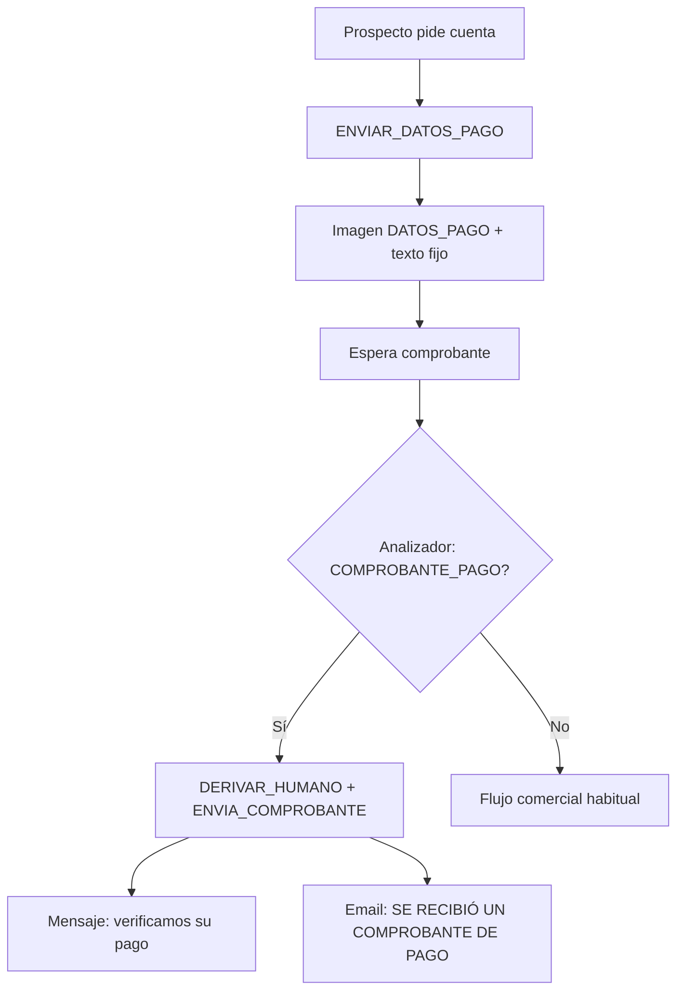

# Datos bancarios por imagen y handoff solo con comprobante

**Fecha:** 15 de octubre de 2026 · **Workflow:** SISTEMA AUTOMATIZADO PEGASO (`09OF22FOxihypeeh`)
**Estado:** implementado y verificado en local. **No** se publicó en n8n, no hay commit ni `git push`. Requiere crear la fila `IMAGEN_DATOS_PAGO` en `configuracion_bot` (sección 4).

Pedir números de cuenta ya no deriva a humano. El bot envía la imagen de datos bancarios y un texto fijo. La derivación humana (con email) ocurre cuando el analizador de imagen clasifica un **comprobante de pago**, con un mensaje sutil al cliente y sin confirmar el pago (riesgo de falsificación).

---

## 1. Decisiones de Pegaso

| Tema | Decisión |
|---|---|
| Pedir cuenta / “dónde deposito” | `ENVIAR_DATOS_PAGO` (no `REGISTRAR_ACEPTACION`: esa acción es aceptar cotización) |
| Imagen | `https://pegasoadhesivos.com/wp-content/uploads/2026/10/Datos-y-numeros-de-cuentas.jpeg` |
| Texto tras la imagen | `Le adjunto nuestros datos personales 📃 y números de cuentas 🏦` |
| Orden | Imagen primero, luego texto (mismo patrón que material/metodología) |
| Tras comprobante detectado | Mensaje: `En este momento le verificamos su pago.` · **No** “gracias por su pago” ni “pago confirmado” |
| Email interno | Asunto y cuerpo: `SE RECIBIÓ UN COMPROBANTE DE PAGO` (reporte de pago solo texto: `SE RECIBIÓ UN REPORTE DE PAGO`) |
| Autenticidad | La IA solo clasifica el aspecto visual; un humano valida el pago |

## 2. Flujo



## 3. Qué se cambió

| Pieza | Cambio |
|---|---|
| Prompt cerebro (§23–24) ×3 | Cuenta → `ENVIAR_DATOS_PAGO`; comprobante → mensaje de verificación |
| Schema accion ×3 | Enum incluye `ENVIAR_DATOS_PAGO` |
| Validadores ×3 | Aceptan `ENVIAR_DATOS_PAGO`; `CONSULTAR_PAGO` permite esa acción |
| Normalizar decisión IA 2.2→2.3 | Convierte `SOLICITA_DATOS_PAGO` → `ENVIAR_DATOS_PAGO`; comprobante fuerza handoff + texto sutil |
| Resolver contexto 3.2→3.3 | Imagen `IMAGEN_DATOS_PAGO` / tema `DATOS_PAGO`; texto fijo |
| Enrutar acción comercial salida 15 | Cableada a Preparar respuesta comercial |
| Obtener configuración | `SELECT` incluye `IMAGEN_DATOS_PAGO` |
| Transición humano 3.1→3.2 | Mensaje de verificación al cliente |
| Notificación 2.1→2.2 | Asunto/cuerpo de comprobante |
| Analizador de imagen ×3 | Señales de bancos Ecuador (Pichincha, Produbanco, Guayaquil, Deuna!, CPN, Jardín Azuayo); no confirmar autenticidad; no confundir con la gráfica “DATOS BANCARIOS” de Pegaso |

Fichas: [FLUJO-WORKFLOW-PEGASO.md](../FLUJO-WORKFLOW-PEGASO.md) §8, §11, §15–16, §18.

## 4. Cómo activarlo

1. **Publicar el workflow** en n8n (cuando Pegaso lo autorice).
2. **Crear la fila de configuración:**

```sql
INSERT INTO pegaso.configuracion_bot (clave, valor_json)
VALUES (
  'IMAGEN_DATOS_PAGO',
  '{"activo": true, "url": "https://pegasoadhesivos.com/wp-content/uploads/2026/10/Datos-y-numeros-de-cuentas.jpeg"}'::jsonb
)
ON CONFLICT (clave) DO UPDATE
SET valor_json = EXCLUDED.valor_json,
    actualizado_at = NOW();
```

3. **Probar**
   - “Pásame la cuenta” → imagen de datos + texto; **sin** email de handoff.
   - Enviar captura tipo transferencia Pichincha/Produbanco/etc. → “En este momento le verificamos su pago” + email con asunto de comprobante.
   - Repetir “pásame la cuenta” en la misma conversación → solo texto (imagen una vez).

## 5. Verificación

Pruebas sobre el código real (`%TEMP%/pegaso-tests/pago-datos.mjs`): **todas OK** (validador, conversión desde `SOLICITA_DATOS_PAGO`, imagen, comprobante, asunto email, transición, cableado switch, prompt, schema, analizador).

`inject-code`, `validate-workflow` (189 nodos), `check-encoding`: OK. `activeVersion` de `edit.json` sin cambios.

## 6. Riesgos y límites

- **Falsificaciones:** el bot no autentica el pago; solo reconoce un comprobante “parecido” y avisa a Pegaso. El humano debe verificar en el banco.
- **Sin fila `IMAGEN_DATOS_PAGO`:** el texto de datos se envía igual, pero sin imagen.
- **“Ya pagué” solo texto (sin imagen):** sigue derivando con `REPORTA_PAGO` y el mismo tono de verificación; el asunto del email es reporte, no comprobante.
- **`REGISTRAR_ACEPTACION` y `VALIDAR_ABONO`** siguen sin destino en el switch.

## 7. Corrección (misma fecha): “ya revisamos la imagen”

En prueba real, tras “Adjunto el abono” + captura de transferencia Pichincha, el bot respondió *Permítame un momento… ya revisamos la imagen…* (ruta `IMAGEN_REQUIERE_REVISION`), no la de comprobante.

**Causa:** la IA visual a veces marca el voucher como `CAPTURA_DE_PANTALLA` o `revision=SI`, y no como `COMPROBANTE_PAGO`.

**Ajuste:** si el cliente escribe abono/comprobante/pago **o** el análisis muestra señales de transferencia, se fuerza `ENVIA_COMPROBANTE` y el mensaje *En este momento le verificamos su pago.* (también si falla el análisis de imagen). Captura bancaria en el prompt = `COMPROBANTE_PAGO`.
