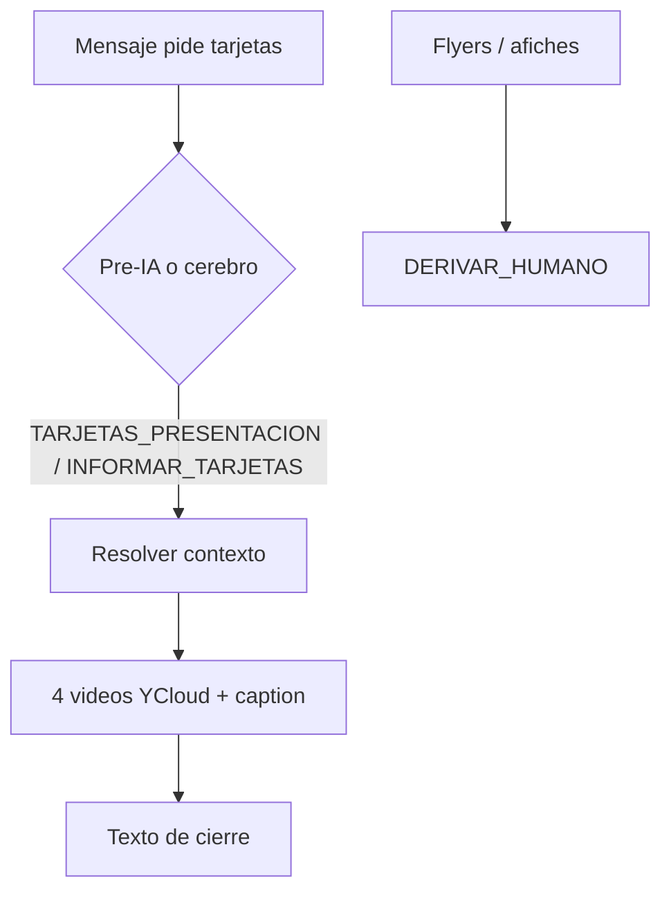

# Tarjetas de presentación: catálogo de acabados con videos

**Fecha:** 19 de octubre de 2026 · **Workflow:** SISTEMA AUTOMATIZADO PEGASO (`09OF22FOxihypeeh`)
**Estado:** Implementado en local (build + edit). **No** publicado en n8n, sin commit ni `git push`. Flyers y afiches siguen derivando a humano.

Cuando el prospecto pide con claridad **tarjetas de presentación** (y no etiquetas), el bot envía los **4 videos de acabados** (con caption de precio) y luego un texto de cierre con material, medida, mínimo y entregas. Ya no responde “solo etiquetas” ni deriva por `PRODUCTO_NO_P4`.

---

## 1. Decisiones de Pegaso

| Tema | Decisión |
|---|---|
| Producto | Tarjetas de presentación (Couche 300 gr, 9×5 cm) |
| Acabados / precios (1000 u.) | UV brillante $24 · Mate $30 · Mate + UV selectivo $40 ($45 con puntas redondeadas) · Mate + Pan de Oro $95 ($100 con puntas) |
| Cantidad | 1000 por diseño; mismo diseño; no se divide |
| Caras | 1 o 2 caras, mismo precio |
| Entregas (no etiquetas) | Abono lun/mar → envío miércoles; mié/jue → viernes |
| Otros Couche 300 gr | Estampitas u otras medidas en múltiplos de 9×5 cm |
| Flyers / afiches | Siguen en `PRODUCTO_NO_P4` → humano (catálogo más adelante) |
| Mezcla etiqueta + tarjeta | No cotizar P4 ni enviar catálogo; aclarar producto |

## 2. Flujo



Orden de envío WhatsApp: videos 1→4 (espera 2 s entre cada uno) → texto de cierre. Si el catálogo ya se envió en la conversación, solo texto.

## 3. Qué se cambió

| Pieza | Cambio |
|---|---|
| Preparar contexto IA 4.6 | Pre-IA `TARJETAS_PRESENTACION` → `INFORMAR_TARJETAS` (también con multimedia). Flyers/afiches siguen en `PRODUCTO_NO_P4` |
| Cerebro ×3 | Prompt §27A + enum `INFORMAR_TARJETAS` |
| Validadores ×3 V2.4 | Aceptan `INFORMAR_TARJETAS` |
| Normalizar decisión IA 2.5 | No deriva por imagen de diseño/meme en ruta tarjetas |
| Resolver contexto comercial 3.5 | Catálogo default + opcional `CATALOGO_TARJETAS`; marca `catalogo_tarjetas.enviada_at` |
| Enrutar acción comercial salida 16 | `VALIDAR_ABONO` → `INFORMAR_TARJETAS` → Preparar respuesta comercial |
| Preparar envío WhatsApp 3.1 | `enviar_videos_tarjetas` + `videos_tarjetas[].body` (`type=video` + caption) |
| Obtener configuración | SQL incluye `CATALOGO_TARJETAS` |
| Nodos nuevos | `IF: ¿Enviar videos tarjetas?` · 4× `YCloud Enviar video tarjetas N` · 4× `Esperar video tarjetas N` |

Fichas en [FLUJO-WORKFLOW-PEGASO.md](../FLUJO-WORKFLOW-PEGASO.md): §2, §11, §16 y pendientes técnicos.

## 4. Cómo activarlo

1. **Publicar el workflow** en n8n (desde el build local).
2. **Opcional — fila de catálogo** (si no existe, el código usa los 4 videos por defecto):

```sql
INSERT INTO pegaso.configuracion_bot (clave, valor_json)
VALUES (
  'CATALOGO_TARJETAS',
  '{
    "activo": true,
    "videos": [
      {
        "clave": "UV_BRILLANTE",
        "url": "https://pegasoadhesivos.com/wp-content/uploads/2026/10/Tarjetas-UV-Brillantes.mp4",
        "caption": "Este es el acabado UV brillante 1000 tarjetas en $24.00 dólares"
      },
      {
        "clave": "MATE",
        "url": "https://pegasoadhesivos.com/wp-content/uploads/2026/10/Tarjetas-Mates.mp4",
        "caption": "Este es el acabado Mate normal 1000 tarjetas en $30.00 dólares."
      },
      {
        "clave": "UV_SELECTIVO",
        "url": "https://pegasoadhesivos.com/wp-content/uploads/2026/10/Tarjetas-UV-Selectivas.mp4",
        "caption": "Este es el acabado Mate  + UV Selectivo 1000 tarjetas en $40.00 dólares\n*Con las puntas redondeadas le saldría en $45.00 dólares."
      },
      {
        "clave": "PAN_DE_ORO",
        "url": "https://pegasoadhesivos.com/wp-content/uploads/2026/10/Tarjetas-Mate-Pan-de-Oro.mp4",
        "caption": "Este es el acabado Mate  + Pan de Oro 1000 tarjetas en $95.00 dólares\n*Con las puntas redondeadas le saldría en $100.00 dólares."
      }
    ]
  }'::jsonb
)
ON CONFLICT (clave) DO UPDATE
SET valor_json = EXCLUDED.valor_json,
    actualizado_at = NOW();
```

Para apagar el envío de videos sin borrar URLs: `"activo": false` en ese JSON.

3. **Probar en WhatsApp** con un teléfono autorizado en `MODO_PRUEBA`: “necesito tarjetas de presentación” / “a como las 1000 tarjetas”.

## 5. Verificación local

- `node scripts/patch-tarjetas.mjs` → prompts 3, schemas 3, SQL, switch 16 cableado, 4 nodos video.
- `node scripts/inject-code.mjs` + `validate-workflow.mjs` → OK (198 nodos).
- Detección de patrones: tarjetas / estampitas+couche → catálogo; etiqueta+tarjeta → no catálogo; volantes/afiches → no_p4.

## 6. Riesgos / siguientes

- Videos grandes: YCloud puede tardar; las esperas de 2 s mitigan el desorden, no garantizan orden estricto en el teléfono.
- Si falla un video (`continueRegularOutput`), el flujo sigue y el texto igual se envía.
- Flyers publicitarios y afiches: pendiente de catálogo propio (hoy derivan).
- Pedido con archivo `.ai`/PDF de tarjeta: no tumba el catálogo; el humano puede entrar después si hace falta revisión de diseño.
