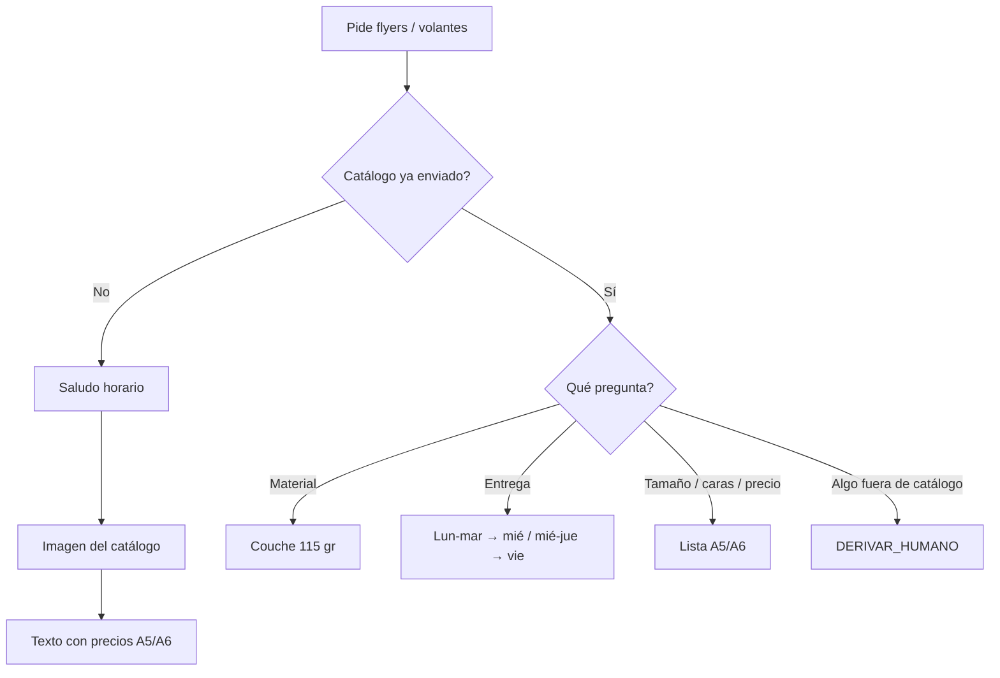

# Volantes / flyers: imagen de catálogo y precios

**Fecha:** 20 de octubre de 2026 · **Workflow:** SISTEMA AUTOMATIZADO PEGASO (`09OF22FOxihypeeh`)
**Estado:** Implementado en local (build + edit). **No** publicado en n8n, sin commit ni `git push`. Afiches siguen derivando a humano.

Cuando el prospecto pide **flyers, flayers o volantes** (y no etiquetas ni tarjetas), el bot saluda según la hora, envía la **imagen del catálogo** y luego el texto con tamaños y precios. Si la imagen falla, el texto igual llega con los precios. Al final: *Los precios adjuntos no incluyen IVA*.

---

## 1. Decisiones de Pegaso

| Tema | Decisión |
|---|---|
| Producto | Volantes / flyers, 1000 unidades |
| A6 10.5 × 14.8 cm | 1 lado $20 · 2 lados $26 |
| A5 21 × 14.8 cm | 1 lado $32 · 2 lados $41 |
| Material | Couche 115 gr |
| Entregas | Igual que tarjetas: abono lun/mar → miércoles; mié/jue → viernes |
| Imagen | Primero la foto, después el texto |
| Fuera de catálogo (A4, otro papel, etc.) | Derivar a humano |
| Afiches | Siguen en `PRODUCTO_NO_P4` → humano |

## 2. Flujo



## 3. Qué se cambió

| Pieza | Cambio |
|---|---|
| Preparar contexto IA 4.8 | Pre-IA `FLYERS_VOLANTES` → `INFORMAR_FLYERS`. Flyers salen de `PRODUCTO_NO_P4` |
| Cerebro ×3 | Prompt §27B + enum `INFORMAR_FLYERS` |
| Validadores ×3 V2.5 | Aceptan `INFORMAR_FLYERS` |
| Resolver 3.7 | `producto_linea = FLYERS_VOLANTES`; imagen + precios; FAQs; desconocido → humano |
| Switch salida 14 | `INFORMAR_FLYERS` → Preparar respuesta comercial |
| Preparar envío 3.3 | Saludo genérico (`enviar_saludo`) + imagen de flyers en `ycloud_request_imagen` |
| Nodos | `IF: ¿Enviar saludo?` delante de videos/imagen (tarjetas y flyers) |

## 4. Cómo activarlo

1. Publicar el workflow.
2. Opcional — fila de catálogo (si no existe, el código usa la URL por defecto):

```sql
INSERT INTO pegaso.configuracion_bot (clave, valor_json)
VALUES (
  'CATALOGO_FLYERS',
  '{
    "activo": true,
    "url": "https://pegasoadhesivos.com/wp-content/uploads/2026/10/Volantes_Mesa-de-trabajo-1-copia-scaled.jpg"
  }'::jsonb
)
ON CONFLICT (clave) DO UPDATE
SET valor_json = EXCLUDED.valor_json,
    actualizado_at = NOW();
```

3. Probar: “necesito volantes A6” / “flyers publicitarios”.
