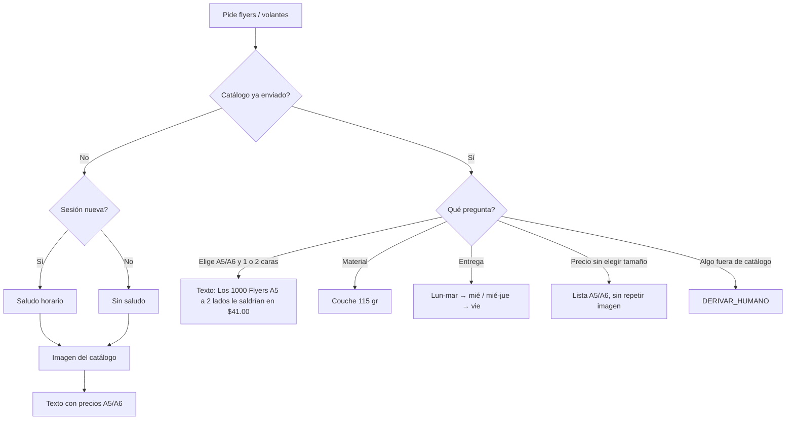

# Volantes / flyers: imagen de catálogo y precios

**Fecha:** 20 de octubre de 2026 · **Workflow:** SISTEMA AUTOMATIZADO PEGASO (`09OF22FOxihypeeh`)
**Estado:** Implementado en local (build + edit). **No** publicado en n8n, sin commit ni `git push`. Afiches siguen derivando a humano.

Cuando el prospecto pide **flyers, flayers o volantes** (y no etiquetas ni tarjetas), el bot envía la **imagen del catálogo** y luego el texto con tamaños y precios. Si después pide el **total** junto con tarjetas (u otro producto de catálogo) y ya dio tamaño y caras, se suma; no se reenvía esta lista. El saludo horario (“Buenos días. Con gusto atenderemos su requerimiento”) **solo** si es el primer contacto de la sesión (sin historial en 24 h). Si ya estaban hablando de tarjetas u otro tema, no se vuelve a saludar. Al final de esa lista: *Precios no incluyen IVA*.

---

## 1. Decisiones de Pegaso

| Tema | Decisión |
|---|---|
| Producto | Volantes / flyers, 1000 unidades |
| A6 10.5 × 14.8 cm | 1 lado $20 · 2 lados $26 |
| A5 21 × 14.8 cm | 1 lado $32 · 2 lados $41 |
| Material | Couche 115 gr |
| Entregas | Igual que tarjetas: abono lun/mar → miércoles; mié/jue → viernes |
| Imagen | Primero la foto, después el texto |
| Fuera de catálogo (A4, otro papel, etc.) | Derivar a humano |
| Afiches | Siguen en `PRODUCTO_NO_P4` → humano |

## 2. Flujo



## 3. Qué se cambió

| Pieza | Cambio |
|---|---|
| Preparar contexto IA 4.8 | Pre-IA `FLYERS_VOLANTES` → `INFORMAR_FLYERS`. Flyers salen de `PRODUCTO_NO_P4` |
| Cerebro ×3 | Prompt §27B + enum `INFORMAR_FLYERS` |
| Validadores ×3 V2.5 | Aceptan `INFORMAR_FLYERS` |
| Resolver 3.11 | Typos (vonates→volantes); mínimo 1000 sin párrafo de estampitas |
| IFs sin salida | Cerebro/extractor ALL_AI_FAILED y audio no listo ahora envían mensaje al cliente |
| Validadores cerebro V2.6 | `CONSULTAR_PRECIO` + `RESPONDER_GENERAL` en flyers/tarjetas es válido: no se gasta OpenAI si DeepSeek ya respondió |
| Switch salida 14 | `INFORMAR_FLYERS` → Preparar respuesta comercial |
| Preparar envío 3.5 | `enviar_saludo` solo si hay `texto_saludo_tarjetas`; imagen de flyers en `ycloud_request_imagen` |
| Nodos | `IF: ¿Enviar saludo?` delante de videos/imagen (tarjetas y flyers) |
| Resolver 3.19 | Tras el catálogo, “Tamaño A5 ambas caras” cotiza esa línea en texto (`Los 1000 Flyers A5 a 2 lados le saldrían en $41.00 dólares`). No reenvía imagen ni la lista. `ambas caras` = 2 lados. |

## 4. Cómo activarlo

1. Publicar el workflow (este arreglo está solo en local hasta el push).
2. La fila `CATALOGO_FLYERS` con `valor_json` NULL no trae URL. El código usa la URL por defecto, pero conviene cargarla:

```sql
UPDATE pegaso.configuracion_bot
SET valor_json = '{
  "activo": true,
  "url": "https://pegasoadhesivos.com/wp-content/uploads/2026/10/Volantes_Mesa-de-trabajo-1-copia-scaled.jpg"
}'::jsonb,
    actualizado_at = NOW()
WHERE clave = 'CATALOGO_FLYERS';
```

3. Probar en una conversación **sin** `catalogo_flyers.enviada_at` (si el intento anterior guardó el catálogo como enviado aunque la foto no llegó, ese chat no reenvía la imagen). “Y disculpe, trabajan con flyers?” en el hilo de tarjetas: precios + foto, **sin** “Buenos días…”. Primer contacto del día pidiendo solo flyers: sí saluda.
