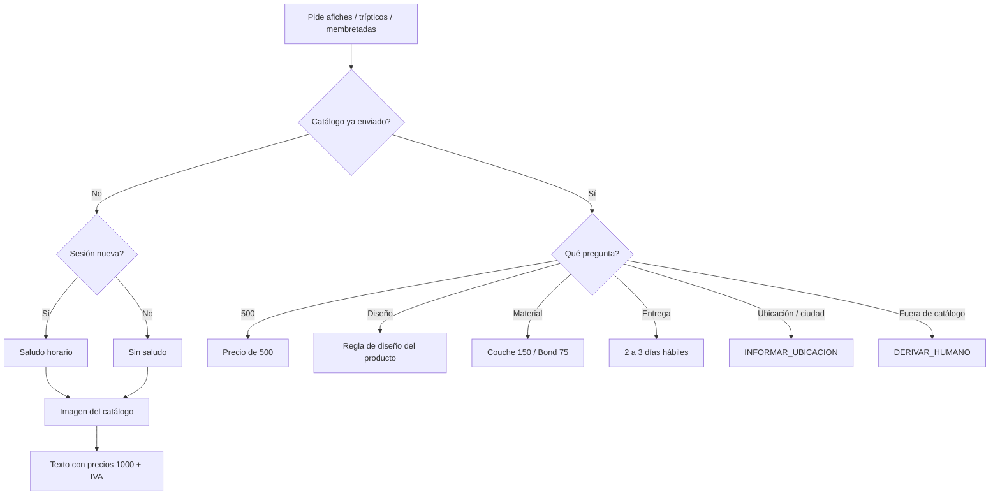

# Producción rápida: afiches, trípticos y hojas membretadas

**Fecha:** 20 de octubre de 2026 · **Workflow:** SISTEMA AUTOMATIZADO PEGASO (`09OF22FOxihypeeh`)
**Estado:** Implementado en local (build + edit). **No** publicado en n8n, sin commit ni `git push`.

Cuando el prospecto pide **afiches**, **trípticos** o **hojas membretadas** (y no etiquetas), el bot envía la **imagen del catálogo** y luego el texto con precios. El saludo horario solo si la sesión es nueva. Al final de cada lista: *Precios no incluyen IVA*. Ubicación, envíos a ciudades y datos de pago reutilizan las FAQs ya existentes. **Dípticos y brochures** siguen a humano.

---

## 1. Decisiones de Pegaso

| Producto | 1000 | 500 (si preguntan) | Diseño | Entrega |
|---|---|---|---|---|
| Afiches A3 (29.7 × 42 cm), full color 1 lado, Couche 150 gr | $100 | $85 | Listo para imprimir: $90 | 2 a 3 días hábiles |
| Trípticos A4 (21 × 29.7 cm), full color ambos lados, doblados y cortados | $85 | $69 | Debe enviar diseño listo; si no, +$15 | 2 a 3 días hábiles |
| Hojas membretadas A4 (21 × 29.7 cm), full color 1 lado, Bond 75 gr | $65 | $50 | Incluye diseño | 2 a 3 días hábiles |

Fuera de ese catálogo (otro tamaño, dípticos, brochures, plastificado, etc.) → `DERIVAR_HUMANO`.

## 2. Flujo



## 3. Qué se cambió

| Pieza | Cambio |
|---|---|
| Preparar contexto IA 4.14 | Pre-IA `AFICHES` / `TRIPTICOS` / `HOJAS_MEMBRETADAS`. Salen de `PRODUCTO_NO_P4`. Dípticos siguen a humano |
| Cerebro ×3 | Prompt §27D + enums `INFORMAR_AFICHES`, `INFORMAR_TRIPTICOS`, `INFORMAR_MEMBRETADAS` |
| Validadores ×3 V2.8 | Aceptan las tres acciones; `RESPONDER_GENERAL` + consulta de catálogo válido |
| Resolver 3.16 | Imagen + lista; FAQ 500 / diseño / material / 2-3 días; totalizador 500 o 1000 |
| Switch salidas 20–22 | Las tres acciones → Preparar respuesta comercial |
| Preparar envío 3.7 | Reutiliza `enviar_imagen_flyers` / `ycloud_request_imagen` |

## 4. Cómo activarlo

1. Publicar el workflow (este arreglo está solo en local hasta el push).
2. Cargar las URLs en `configuracion_bot` (el código tiene URL por defecto si la fila no existe o viene null):

```sql
INSERT INTO pegaso.configuracion_bot (clave, valor_json, actualizado_at)
VALUES
  ('CATALOGO_AFICHES', '{"activo": true, "url": "https://pegasoadhesivos.com/wp-content/uploads/2026/10/Afiches-Publicitarios-scaled.jpg"}'::jsonb, NOW()),
  ('CATALOGO_TRIPTICOS', '{"activo": true, "url": "https://pegasoadhesivos.com/wp-content/uploads/2026/10/tripticos_Mesa-de-trabajo-1-copia-6-scaled.jpg"}'::jsonb, NOW()),
  ('CATALOGO_MEMBRETADAS', '{"activo": true, "url": "https://pegasoadhesivos.com/wp-content/uploads/2026/10/Hojas-Membretadas-scaled.jpg"}'::jsonb, NOW())
ON CONFLICT (clave) DO UPDATE
SET valor_json = EXCLUDED.valor_json,
    actualizado_at = NOW();
```

3. Probar en conversaciones **sin** `catalogo_afiches` / `catalogo_tripticos` / `catalogo_membretadas` enviados. Primer contacto del día: saluda. En un hilo ya abierto (p. ej. tarjetas): imagen + precios, **sin** “Buenos días…”. “¿Envían a Guayaquil?” o “¿dónde están?” deben seguir las FAQs de ubicación, no la entrega de 2-3 días.
